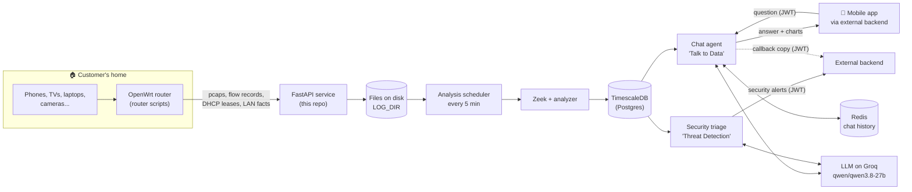

# Routica AI: Onboarding Guide (Start Here)

This folder explains the `core` project from end to end in plain words: what it does, how data flows, how to run it, which credentials it needs and where the traps are.

> **How to read it:** start with `01` and follow the **Next →** link at the bottom of each page. Every page also links back to this index.
> Code links such as [`app/main.py`](../core/app/main.py) open the real file in `../core`.

Facts were checked against the code on **2026-10-12** (branch `master`, last commit `0cc6ffc`). Where the code and the docs disagree, this guide follows the code and says so.

---

## Reading order

| # | Page | You will learn |
|---|---|---|
| 01 | [The big picture](01-big-picture.md) | What Routica AI is, its two products, a story of one byte |
| 02 | [Architecture](02-architecture.md) | All the moving parts and how they connect (diagrams) |
| 03 | [Repo tour](03-repo-tour.md) | Which folder and file does what |
| 04 | [Router side](04-router-side.md) | The shell scripts on the OpenWrt router that send data |
| 05 | [API endpoints](05-api-endpoints.md) | Every HTTP endpoint, its input, output and auth |
| 06 | [Analysis pipeline](06-analysis-pipeline.md) | Scheduler → Zeek → analyzer → database, every 5 minutes |
| 07 | [Database](07-database.md) | Tables, TimescaleDB, aggregates, migrations |
| 08 | [Chat agent ("Talk to Data")](08-chat-agent.md) | How a question becomes an answer and a chart |
| 09 | [Security triage ("Threat Detection")](09-security-triage.md) | Detectors, LLM triage, findings, alerts |
| 10 | [Configuration and credentials](10-config-and-credentials.md) | Every env var and secret, which are required |
| 11 | [Running it locally](11-running-locally.md) | Setup and commands, plus a first end-to-end test with curl |
| 12 | [Build, deploy and CI](12-build-deploy-ci.md) | Docker images, GitHub workflows, the deploy |
| 13 | [Testing and evaluation](13-testing-and-evaluation.md) | Unit tests, and how chat and security quality are measured |
| 14 | [Traps and gotchas](14-traps-and-gotchas.md) | The things that cost the team days, so they don't cost you |
| 15 | [Map of existing docs](15-existing-docs-map.md) | What each long doc in `core/docs` covers and when to read it |
| 16 | [Glossary and cheat sheet](16-glossary-and-cheatsheet.md) | Terms, and the most-used commands on one page |

---

## The whole system on one screen

**In one sentence:** the router ships traffic data, the service turns it into per-device facts every 5 minutes, and two AI features read those facts: one answers the customer's questions, the other looks for threats.

---

**Next →** [01 · The big picture](01-big-picture.md)
