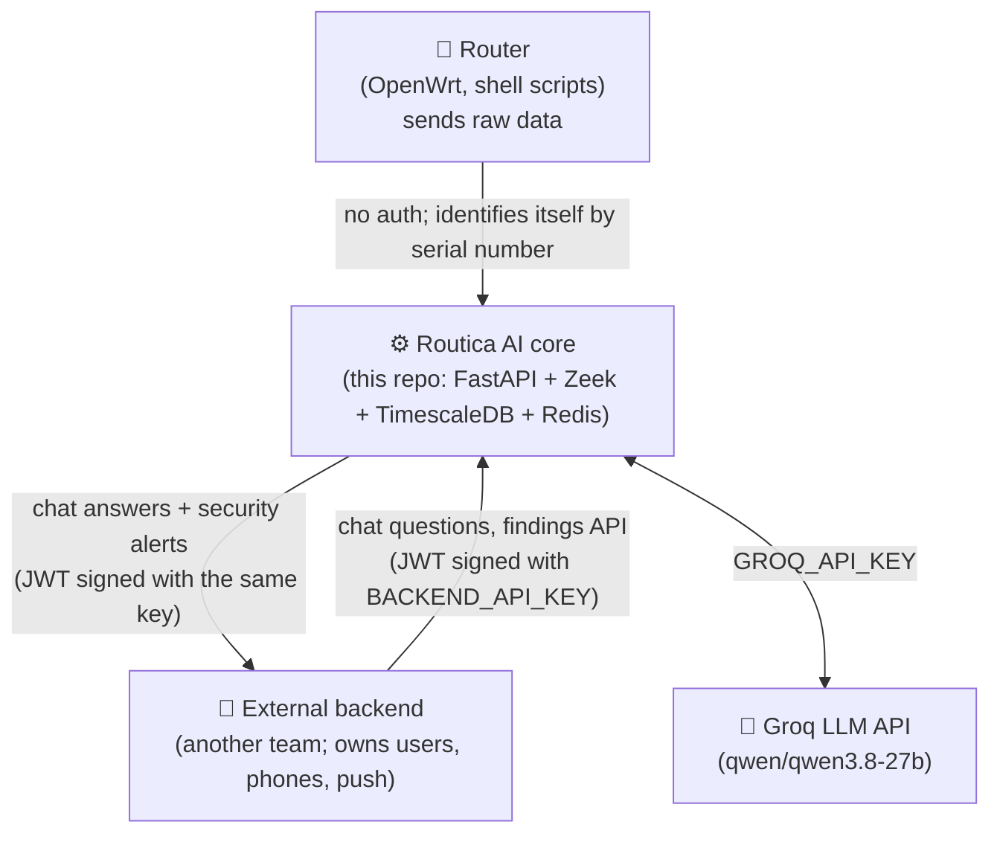
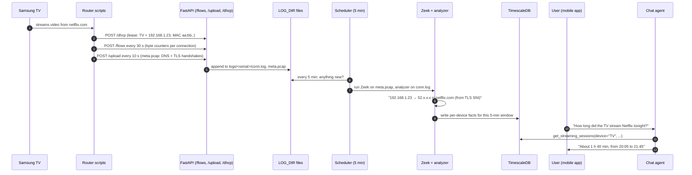
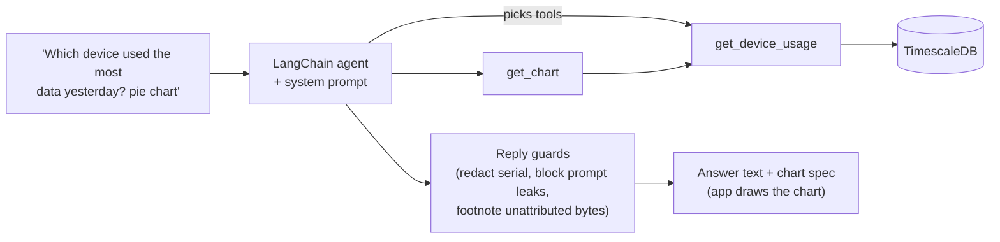
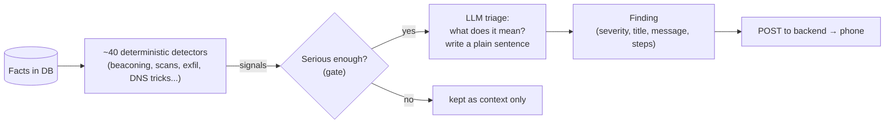

# 01 · The big picture

[← Index](00-START-HERE.md) · **Next →** [02 · Architecture](02-architecture.md)

---

## What is Routica AI?

Routica sells home routers (OpenWrt firmware). **Routica AI** is the cloud service, in this repo, that makes those routers smart:

1. The router quietly records **who in the house talks to what on the internet**: device, destination, bytes and time.
2. Every 5 minutes this service crunches that into tidy facts per device, such as "the Samsung TV downloaded 1.2 GB from netflix.com between 20:00 and 20:05".
3. Two AI features read those facts:

| Product | What the customer gets | Code |
|---|---|---|
| 💬 **Talk to Data** (chat) | Ask in plain English: *"Which device used the most data yesterday?"*, *"How long was the kids' iPad on YouTube?"*, *"Show me a pie chart of websites this week"* | `app/services/agent_*.py`, `agent_tools.py` |
| 🛡️ **Threat Detection** (security triage) | An alert on the phone: *"Your laptop keeps contacting an unfamiliar server in a pattern typical of malware"* | `app/services/security/` |

The service has **no UI of its own** (except two small security HTML pages for ops). The customer uses a **mobile app**, which talks to a **separate backend** owned by another team. That backend calls this service and receives answers and alerts back.

---

## The four actors

---

## A story: the life of one byte

Follow one Netflix stream from the TV to an answer in the app.

Key ideas in that story:

- **The router serial number is the identity everywhere.** In the code it is called `hostname` (confusing, but consistent). It maps to `router_info.serial_number` → `router_id`.
- **DHCP leases matter.** The analyzer only counts traffic from IPs that have a known DHCP lease. No leases means traffic is counted as "unattributed" (see [14 · Traps](14-traps-and-gotchas.md)).
- **Names come from TLS handshakes (SNI) first, DNS second.** Most traffic is encrypted, but the first packet of a TLS or QUIC connection says which site it is for.
- **Everything is chopped into 5-minute windows.** Each database row has a `ts` floored to a 5-minute boundary.

---

## Talk to Data in one picture

## Threat Detection in one picture

Design rule from the team: **detectors decide WHO gets looked at, the LLM decides WHAT IT MEANS.** The LLM cannot lower a severity below the floor a detector sets.

---

## Tech stack at a glance

| Layer | Tech |
|---|---|
| Language | Python 3.12 |
| Web | FastAPI 0.109, uvicorn |
| Traffic parsing | Zeek 7.0.0 (built from source), custom analyzer `zeek_analyzerv2.py`, custom SNI/QUIC reader |
| Database | PostgreSQL 16 + TimescaleDB (hypertables, continuous aggregates); SQLAlchemy 2 + Alembic |
| Chat memory | Redis Stack (RediSearch) via `langgraph-checkpoint-redis` |
| AI | LangChain 1.0 / LangGraph 1.0, Groq API (`qwen/qwen3.8-27b`), OpenAI optional |
| Scheduling | APScheduler (thread-based) |
| Observability | Langfuse (optional) |
| Packaging | Docker (zeek-base → app image), GitHub Actions, SSH deploy to a Windows host |

---

[← Index](00-START-HERE.md) · **Next →** [02 · Architecture](02-architecture.md)
