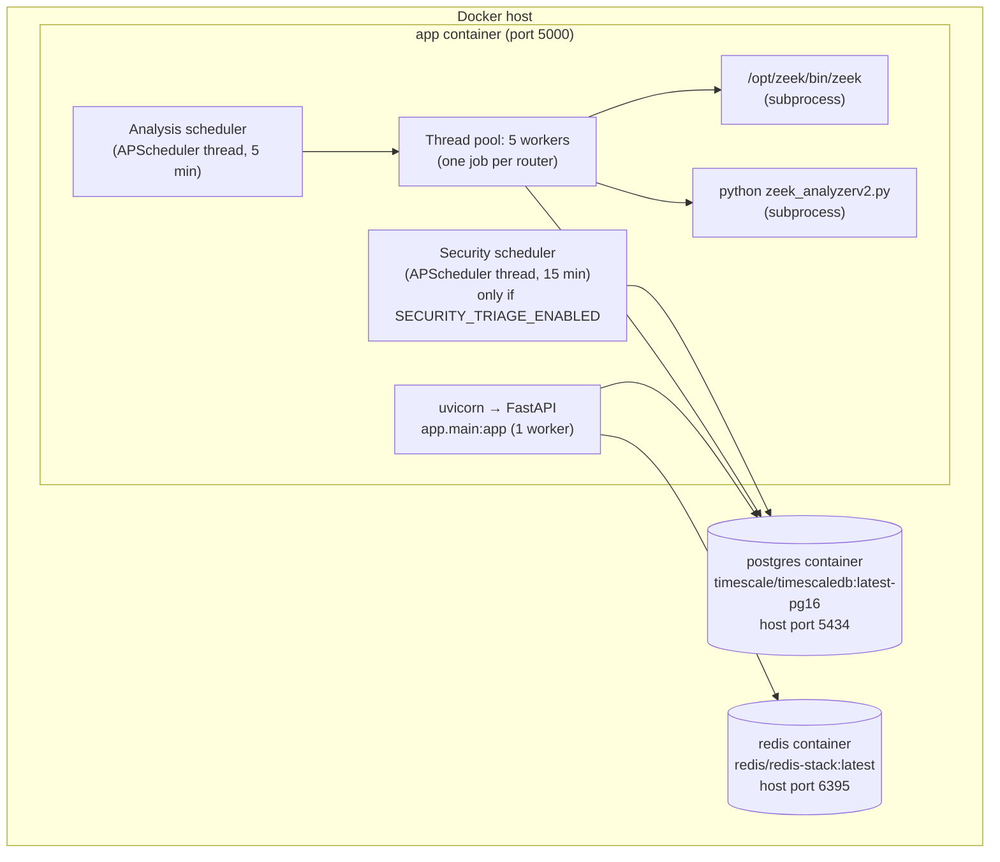
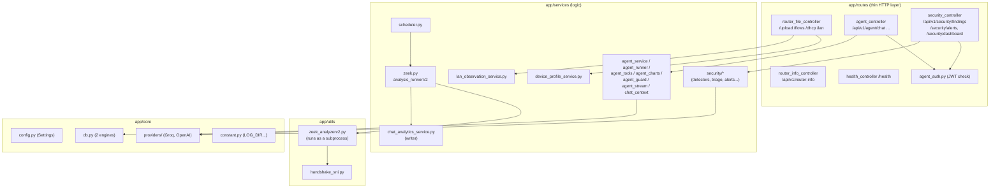
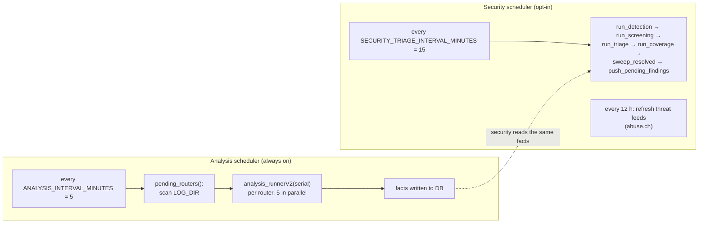
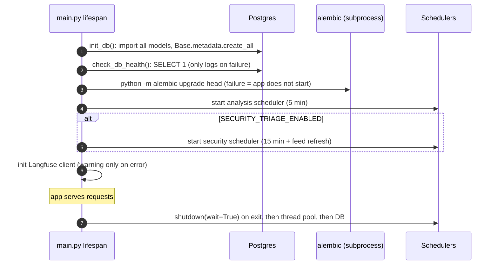
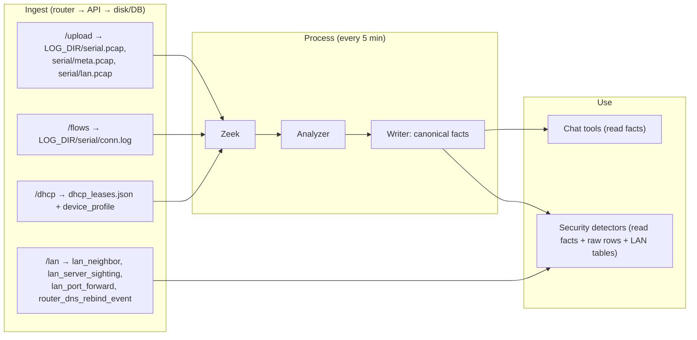

# 02 · Architecture

[← 01 · Big picture](01-big-picture.md) · [Index](00-START-HERE.md) · **Next →** [03 · Repo tour](03-repo-tour.md)

---

## 1. Containers and processes

In production everything runs as **three containers** (see `docker-compose.yml` / `docker-compose.local.yml`):

Important: the API, both schedulers and the analysis threads all live in **one Python process**. There is no Celery and no separate worker container.

---

## 2. Layers inside the app

Convention: **routes stay thin, logic lives in `app/services`.**

---

## 3. Two database engines

From [`app/core/db.py`](../core/app/core/db.py):

| Engine | Driver | Used by | How to get a session |
|---|---|---|---|
| **Async** | `asyncpg` (`postgresql+asyncpg://...`) | HTTP handlers, chat tools | `get_db()` (FastAPI dependency) or `async with get_session()` |
| **Sync** | `psycopg2` (same URL minus `+asyncpg`) | Scheduler threads (analysis, security), Alembic | `with get_sync_session():` |

Rule: **anything the scheduler calls must use `get_sync_session()`.** Scheduler threads have no event loop.

---

## 4. Two schedulers

Both skip **evaluation routers**, whose serials start with `PCAP-`, `SYN-` or `EVAL-`. Test harnesses drive those themselves.

---

## 5. Startup sequence (order matters!)

From [`app/main.py`](../core/app/main.py) `lifespan()`:

**Why `create_all` runs before migrations:** the migrations (hypertables, aggregates, extra columns) assume the tables already exist.

---

## 6. Data flows at a glance

---

## 7. Outbound calls the service makes

| To | When | Auth | Code |
|---|---|---|---|
| `{BACKEND_URL}/agent/chat` | Once per chat turn (answer or "AI unavailable") | Bearer JWT (HS256, key = base64-decoded `BACKEND_API_KEY`, 5-min expiry) | `agent_chat_callback_service.py` |
| `{BACKEND_URL}{SECURITY_ALERT_PATH}` (default `/api/v1/notifications/security-alert`) | Each new or escalated finding | Same JWT | `security/alert_callback.py` |
| Groq API | Chat turns, screening, triage | `GROQ_API_KEY` | `core/providers/groq.py` |
| Langfuse | Traces (optional) | `LANGFUSE_*` keys | `chat_tracing.py`, `security/tracing.py` |
| iptoasn.com, abuse.ch, RDAP/WHOIS, crt.sh, Spamhaus DNS | Security enrichment (no keys) | none | `security/asn_lookup.py`, `threat_feeds.py`, `external_lookup.py` |

---

[← 01 · Big picture](01-big-picture.md) · [Index](00-START-HERE.md) · **Next →** [03 · Repo tour](03-repo-tour.md)
