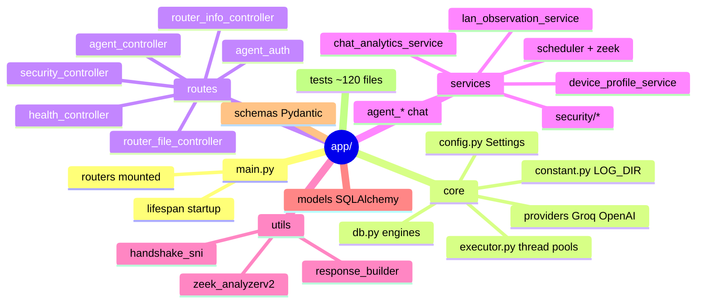

# 03 · Repo tour

[← 02 · Architecture](02-architecture.md) · [Index](00-START-HERE.md) · **Next →** [04 · Router side](04-router-side.md)

---

## Top level of `core/`

```
core/
├── app/                      ← the FastAPI service (everything that runs in production)
├── alembic/ + alembic.ini    ← database migrations (38, one straight chain)
├── scripts/
│   ├── router_scripts/       ← shell scripts that run ON THE ROUTER (copied by hand)
│   ├── eval/                 ← evaluation harnesses (chat quality, security replay, ATT&CK)
│   ├── eval_triage.py        ← triage prompt vs labelled cases
│   └── audit_grounding.py    ← checks findings don't claim things their evidence lacks
├── docs/                     ← 6 long engineering docs (see page 15)
├── Dockerfile                ← app image (FROM zeek-base)
├── Zeek.Dockerfile           ← base image: Python 3.12 + Zeek 7.0.0 built from source
├── Suricata.Dockerfile       ← base image kept so DPI can be restored (unused today)
├── docker-compose.yml        ← staging stack (reads staging.env, builds the image)
├── docker-compose.local.yml  ← local/deployed stack (reads .env, pulls the image)
├── dev.env.example           ← every env var, with comments → copy to dev.env
├── requirements.txt          ← pinned Python deps (no pytest, no linters)
├── CLAUDE.md                 ← the team's dense "everything you must know" file
└── .github/workflows/        ← AI PR review, build+deploy, base-image builds
```

> ⚠️ `.gitignore` ends with `*.md`, so every Markdown file is ignored. The docs are tracked only because they were force-added. **A new or changed doc needs `git add -f`.**

---

## `app/`: the service



### `app/core/`

| File | What it does |
|---|---|
| [`config.py`](../core/app/core/config.py) | `Settings` (pydantic-settings). Loads `dev.env`. Validators for the API key, model, timeouts |
| [`db.py`](../core/app/core/db.py) | `Base`, async engine + `get_db`/`get_session`, sync engine + `get_sync_session`, `init_db` (create_all) |
| [`constant.py`](../core/app/core/constant.py) | `BASE_DIR`, **`LOG_DIR = BASE_DIR/logs`**, `ANALYSIS_DIR = LOG_DIR/analysis`, analyzer path, `MIN_API_KEY_LENGTH` |
| [`executor.py`](../core/app/core/executor.py) | `executor` (8 threads, blocking request work), `scheduler_executor` (5 threads, per-router analysis) |
| `providers/` | `GroqProvider` (ChatGroq), `OpenAIProvider` (ChatOpenAI), `factory.py`, `llm_registry.get_provider` (cached) |

### `app/routes/` (HTTP, thin)

| File | Endpoints |
|---|---|
| [`health_controller.py`](../core/app/routes/health_controller.py) | `GET /health` |
| [`router_file_controller.py`](../core/app/routes/router_file_controller.py) | `POST /upload`, `/flows`, `/dhcp`, `/lan` (router ingest, no auth) |
| [`router_info_controller.py`](../core/app/routes/router_info_controller.py) | `/api/v1/router-info/...` register and list routers |
| [`agent_controller.py`](../core/app/routes/agent_controller.py) | `/api/v1/agent/chat`, `/chat/stream`, `/chat/clear`, `/chat/compact` |
| [`agent_auth.py`](../core/app/routes/agent_auth.py) | Bearer JWT dependency |
| [`security_controller.py`](../core/app/routes/security_controller.py) | `/api/v1/security/findings`, `/security/alerts`, `/security/dashboard` |

### `app/services/` (logic)

| Area | Files |
|---|---|
| **Analysis** | [`scheduler.py`](../core/app/services/scheduler.py) (5-min job), [`zeek.py`](../core/app/services/zeek.py) (`analysis_runnerV2`), [`chat_analytics_service.py`](../core/app/services/chat_analytics_service.py) (writes facts) |
| **Devices / LAN** | [`device_profile_service.py`](../core/app/services/device_profile_service.py), [`lan_observation_service.py`](../core/app/services/lan_observation_service.py), [`router_info_service.py`](../core/app/services/router_info_service.py) |
| **Chat** | [`agent_service.py`](../core/app/services/agent_service.py) (build agent, system prompt), [`agent_runner.py`](../core/app/services/agent_runner.py) (one turn, retries), [`agent_tools.py`](../core/app/services/agent_tools.py) (9 tools, 4,300 lines), [`agent_charts.py`](../core/app/services/agent_charts.py), [`agent_guard.py`](../core/app/services/agent_guard.py), [`agent_stream.py`](../core/app/services/agent_stream.py), [`chat_context.py`](../core/app/services/chat_context.py), [`chat_tracing.py`](../core/app/services/chat_tracing.py) |
| **Auth / callback** | [`agent_auth_service.py`](../core/app/services/agent_auth_service.py) (mint and validate JWT), [`agent_chat_callback_service.py`](../core/app/services/agent_chat_callback_service.py) |
| **Security** | `security/` (29 files, see [09](09-security-triage.md)) |

### `app/utils/`

| File | What |
|---|---|
| [`zeek_analyzerv2.py`](../core/app/utils/zeek_analyzerv2.py) | **The** analyzer (2,300 lines). Run as a *subprocess*: Zeek logs + DHCP leases → per-device JSON |
| [`handshake_sni.py`](../core/app/utils/handshake_sni.py) | Reads site names from TLS ClientHello and decrypts QUIC Initial packets in `meta.pcap` |
| [`response_builder.py`](../core/app/utils/response_builder.py) | Standard `{status, message, data, timestamp}` JSON responses |

### `app/models/` and `app/schemas/`

- `models/`: SQLAlchemy tables (`router_info`, `device_profile`, the 7 canonical facts, security tables, LAN tables). See [07 · Database](07-database.md).
- `schemas/`: Pydantic request and response shapes (`agent.py`, `RouterInfoRequest.py`, `response.py`).

---

## `scripts/`

| Folder | What | Page |
|---|---|---|
| `router_scripts/` | `capture.sh`, `pcap_uploader.sh`, `flow_reporter.sh`, `dhcp_monitor.sh`, `lan_reporter.sh`, `healthcheck.sh`, `routica_ai.sh`, `config`, `README.md` | [04](04-router-side.md) |
| `eval/` | `evaluate_chat.py` (+ `chat_pipeline/`), `chat_eval.py`, `replay_pcap.py`, `replay_suite.py`, `evaluate_attack.py` (+ `attack_benchmark/`), `price_new_detectors.py`... | [13](13-testing-and-evaluation.md) |

---

## Where to look first when...

| You want to... | Open |
|---|---|
| Understand startup | `app/main.py` |
| Add an env var | `app/core/config.py` **and** `dev.env.example` |
| Change what the router sends | `scripts/router_scripts/*` + `app/routes/router_file_controller.py` |
| Change how traffic is interpreted | `app/utils/zeek_analyzerv2.py` |
| Change what is stored | `app/services/chat_analytics_service.py` + model + Alembic migration |
| Change chat behaviour | `agent_service.py` (prompt), `agent_tools.py` (data), `agent_runner.py` (retries) |
| Add a security detector | `security/detectors.py`, `signal_service.py`, a gate set in `triage_service.py` |

---

[← 02 · Architecture](02-architecture.md) · [Index](00-START-HERE.md) · **Next →** [04 · Router side](04-router-side.md)
