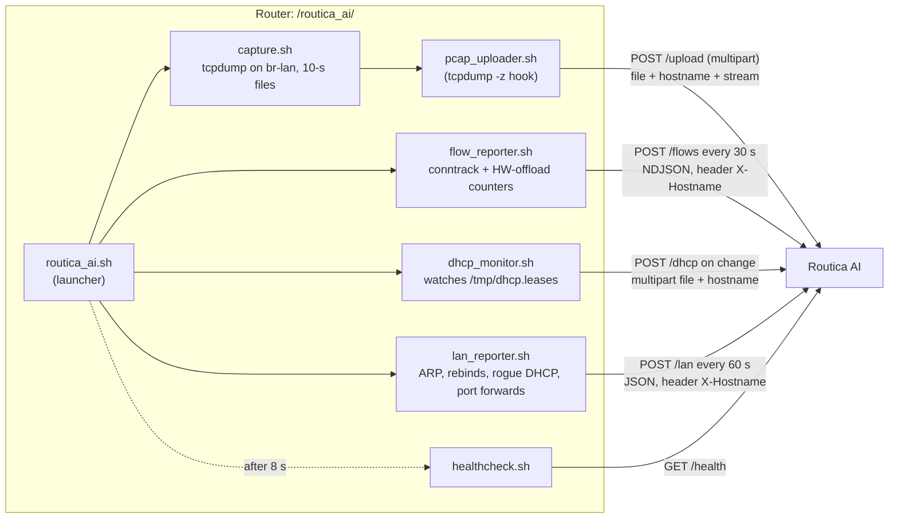

# 04 · Router side (what runs on the OpenWrt router)

[← 03 · Repo tour](03-repo-tour.md) · [Index](00-START-HERE.md) · **Next →** [05 · API endpoints](05-api-endpoints.md)

---

The router runs small **shell scripts** from [`scripts/router_scripts/`](../core/scripts/router_scripts/). Nothing deploys them automatically: they are **copied by hand** to `/routica_ai/` on the router and started at boot by `/etc/rc.local` → `sh /routica_ai/routica_ai.sh &`.

The reference router is an MT7981 (Z8106) on vendor OpenWrt with BusyBox.

---

## The scripts and what they send



| Script | What it does | Sends to |
|---|---|---|
| `routica_ai.sh` | Kills old copies, `killall tcpdump`, starts the 4 collectors, then runs the health check | n/a |
| `capture.sh` | Up to 3 `tcpdump`s on `br-lan`, each writing a new file every **10 s** (`-G 10`) and calling `pcap_uploader.sh` | via the uploader |
| `pcap_uploader.sh` | Uploads one pcap file, then **always deletes it** (`/tmp` is RAM) | `POST /upload` |
| `flow_reporter.sh` | Samples per-connection byte counters every **5 s**, uploads every **30 s** as Zeek-`conn.log`-shaped JSON lines | `POST /flows` |
| `dhcp_monitor.sh` | Posts the dnsmasq lease file at start and whenever it changes (checks every 5 s) | `POST /dhcp` |
| `lan_reporter.sh` | Every 60 s: neighbour (ARP) table, dnsmasq DNS-rebind warnings, foreign DHCP servers / IPv6 router adverts, UPnP and static port forwards | `POST /lan` |
| `healthcheck.sh` | Checks `/health`, process counts, upload errors, lease file. Exits 1 on any FAIL | `GET /health` |
| `config` | Settings sourced by every script | n/a |

---

## The three captures in `capture.sh`

| Capture | On by default? | Filter | Becomes on the server |
|---|---|---|---|
| **Names capture** (`meta_*.pcap`) | ✅ always | DNS (port 53) + TLS **handshake records only** on 443 + QUIC long-header packets on UDP 443 | `LOG_DIR/<serial>/meta.pcap`, which gives site names |
| **LAN capture** (`lan_*.pcap`) | ✅ (`LAN_CAPTURE=1`) | private → private traffic (device to device) | `LOG_DIR/<serial>/lan.pcap` |
| **Accounting capture** (`capture_*.pcap`) | ❌ (`ACCOUNTING_CAPTURE=0`) | everything, snaplen 96 | `LOG_DIR/<serial>.pcap` (old pcap-only mode) |

The accounting capture is off because it lost 80.9% of packets and cost ~1 GB/day. **The flow reporter replaces it**: it reads byte counters from the kernel (`conntrack -L`) and from the hardware offload table (`/sys/kernel/debug/hnat/all_entry`), which see every byte even when packets bypass the CPU.

---

## Identity and auth

- **There is no auth on the router → server path.** No token, no signature.
- The router identifies itself by its **serial number**, read with `osimodel -r | grep serial`:
  - `/upload` and `/dhcp`: form field `hostname=<serial>`
  - `/flows` and `/lan`: header `X-Hostname: <serial>`
- `FLOW_HOSTNAME` overrides the serial (used in tests).

---

## `config` variables

| Var | Default | Meaning |
|---|---|---|
| `ROUTICA_SERVER` | `http://216.171.106.10:6000` | Where to send data (production) |
| `ACCOUNTING_CAPTURE` | `0` | Full-traffic tcpdump (off) |
| `SNAPLEN` | `96` | Snaplen for the accounting capture |
| `CAPTURE_TLS_CERTS` | `0` | `1` = capture all TCP 443 (≈10× bandwidth) |
| `FLOW_INTERVAL` | `30` s | Flow upload cadence |
| `FLOW_SAMPLE_INTERVAL` | `5` s | Counter sampling (short because HW-offload entries get evicted) |
| `LAN_CAPTURE` | `1` | Device-to-device capture |
| `LAN_SNAPLEN` / `LAN_FILTER` | `96` / RFC1918↔RFC1918 | LAN capture settings |

---

## What a flow record looks like

`flow_reporter.sh` writes one JSON line per changed flow per sample, shaped like Zeek's `conn.log`:

```json
{"ts": 1760270400.0, "uid": "F<key>", "id.orig_h": "192.168.1.23", "id.orig_p": 51544,
 "id.resp_h": "52.1.2.3", "id.resp_p": 443, "proto": "tcp", "conn_state": "ESTABLISHED",
 "duration": 125.0, "flow_first_seen": 1760270275.0,
 "orig_bytes": 1200, "resp_bytes": 980000, "orig_ip_bytes": 1500, "resp_ip_bytes": 1010000,
 "orig_pkts": 20, "resp_pkts": 700, "local_orig": true, "local_resp": false, "missed_bytes": 0}
```

> ⚠️ Unlike real Zeek, there is **one record per 5-s sample**: bytes are the *delta* for that sample, and `duration` is the flow's *lifetime so far*. Never add up `duration` across records. See [14 · Traps](14-traps-and-gotchas.md).

Only **LAN-originated** flows are reported. LAN↔LAN, multicast and the router's own traffic are excluded.

---

## Operating the router (from the router README and CLAUDE.md)

- The router has **no `setsid`, `nohup` or `timeout`**. Background a command and `kill` it after `sleep N` instead.
- A script started over SSH dies with the session. Start it detached:
  ```sh
  start-stop-daemon -S -b -m -p /var/run/flow_reporter.pid -x /bin/sh -- /routica_ai/flow_reporter.sh
  ```
- Stop with `start-stop-daemon -K -p /var/run/X.pid`, then **wait for the pid to exit** (up to the script's current `sleep`) before starting again.
- Verify by **pidfile**, not `healthcheck.sh` (its `ps | grep` can match your own SSH command line).
- Restarting `flow_reporter.sh` empties its accumulator. Do it right after an upload, or you lose up to 30 s of bytes.
- **Update procedure:** back up to `.bak-YYYYMMDD`, copy the new file in as `.new`, check `md5sum`, `mv` it over the old one, `chmod 755`, restart that collector.
- Shell tests for these scripts live in `app/tests/test_*.sh` (run with `sh`, not pytest).

---

[← 03 · Repo tour](03-repo-tour.md) · [Index](00-START-HERE.md) · **Next →** [05 · API endpoints](05-api-endpoints.md)
