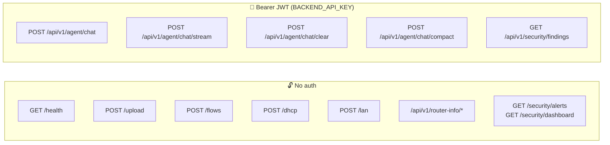
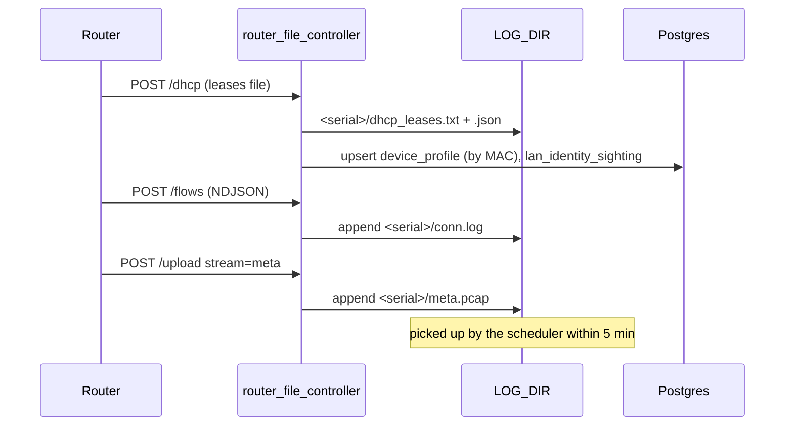
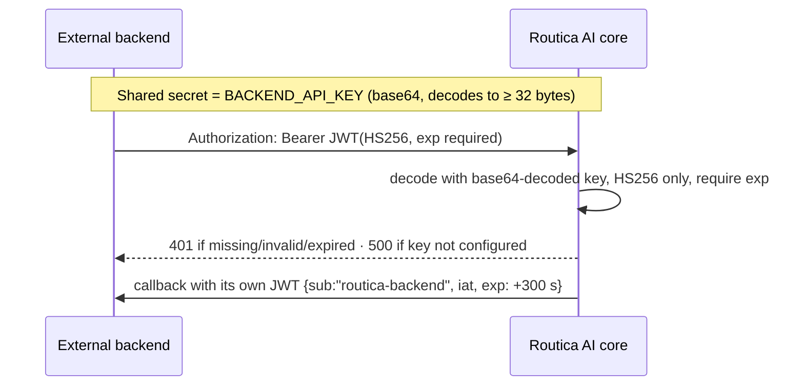

# 05 · API endpoints

[← 04 · Router side](04-router-side.md) · [Index](00-START-HERE.md) · **Next →** [06 · Analysis pipeline](06-analysis-pipeline.md)

---

Routers are mounted in [`app/main.py`](../core/app/main.py). Prefixes are **mixed**:

- **No prefix:** `/health`, `/upload`, `/flows`, `/dhcp`, `/lan`, `/security/alerts`, `/security/dashboard`
- **Under `/api/v1`** (`settings.API_V1`): router-info, agent, security findings

Local dev server: `http://localhost:5000`. Docker local: `http://localhost:8050`. The router's production default is port `6000`.



---

## Router ingest (no auth)

| Endpoint | Input | What it does |
|---|---|---|
| `GET /health` | n/a | `{status: "healthy", version}`. Used by the Docker healthcheck. **Must stay unprefixed.** |
| `POST /upload` | multipart: `file`, `hostname`, `stream` (`meta` / `lan` / default `conn`) | Appends the pcap to `LOG_DIR/<h>/meta.pcap`, `LOG_DIR/<h>/lan.pcap` or `LOG_DIR/<h>.pcap`. On later appends it strips the 24-byte pcap header. No DB. |
| `POST /flows` | header `X-Hostname`; body NDJSON | Drops malformed lines and appends the rest to `LOG_DIR/<h>/conn.log`. No DB. |
| `POST /dhcp` | multipart: `file` (dnsmasq leases), `hostname` | Writes `dhcp_leases.txt` and merges into `dhcp_leases.json` (entries are never removed). Upserts `device_profile` (by MAC) and `lan_identity_sighting`. Returns 200 even if the router is unknown (message says "DB save failed"). |
| `POST /lan` | header `X-Hostname`; JSON | Upserts `lan_neighbor`, `router_dns_rebind_event`, `lan_port_forward`, `lan_server_sighting`. Unknown router → **404**. |



---

## Router registry (no auth)

| Endpoint | Body / params | Result |
|---|---|---|
| `POST /api/v1/router-info/` | `{"serial_number": "RQ01000039", "model": "Z8106", "firmware_version": "1.0"}` | 201 + router. If the serial exists, updates `last_seen` |
| `GET /api/v1/router-info/{serial}` | n/a | the router, or 404 |
| `GET /api/v1/router-info/` | n/a | list of all routers |
| `PATCH /api/v1/router-info/{serial}/heartbeat` | n/a | updates `last_seen` |

No router script calls these. Registration probably comes from the external backend (this is a guess; not confirmed). The analysis pipeline also creates a `router_info` row automatically (model "Unknown") the first time it writes data for a serial.

---

## Chat (JWT)

| Endpoint | Body | Returns |
|---|---|---|
| `POST /api/v1/agent/chat` | `{"message": "...", "hostname": "<serial>", "chatId": 42}` | `{output, thread_id, hostname, latency, chart, charts, metadata}` |
| `POST /api/v1/agent/chat/stream` | same | Server-sent events: `status`, `delta`, `reset`, then `final` or `error` |
| `POST /api/v1/agent/chat/clear` | `{"hostname", "chatId"}` | `{cleared, chatId, removed_messages, reply}`. No callback |
| `POST /api/v1/agent/chat/compact` | `{"hostname", "chatId"}` | `{compacted, kept_messages, removed_messages, ...}`. No callback |

Rules:
- `message` must be non-empty and at most **2,000 chars** (`CHAT_MESSAGE_MAX_CHARS`), otherwise 422.
- `hostname` must be a registered router, otherwise 404 "Router not registered."
- Typing `/clear` or `/compact` as the whole message does the same as those endpoints, but **does** send the backend callback.
- Every `/chat` and `/chat/stream` turn sends **exactly one** callback to `{BACKEND_URL}/agent/chat`.

Details in [08 · Chat agent](08-chat-agent.md).

---

## Security (mixed)

| Endpoint | Auth | Params | Returns |
|---|---|---|---|
| `GET /api/v1/security/findings` | JWT | `limit` (1-200, default 50), `severity` (this level and above), `severity_exact`, `serial`, `since` (ISO; naive = UTC), `include_benign` (false) | `{count, total, findings[]}` |
| `GET /security/alerts` | none | `router`, `severity` | HTML list (100 rows) |
| `GET /security/dashboard` | none | n/a | HTML ops dashboard ("is triage working?") |

---

## How the JWT works (both directions)



- Validation: [`agent_auth_service.py`](../core/app/services/agent_auth_service.py). Only `exp` is required; `sub`, `aud` and `iss` are not checked.
- To mint a test token yourself, see [11 · Running locally](11-running-locally.md#mint-a-jwt-for-testing).

---

## Response and error format

Most non-agent endpoints return `ResponseEntity`:

```json
{"status": "success", "message": "Request successful", "data": {...}, "timestamp": "2026-10-12T10:00:00Z"}
```

Errors (from `app/exception/handler.py`):
- `HTTPException` → `{status: "error", message: <detail>, data: {error, path}}`
- validation error → 422 `"Invalid request data"` with `data.errors[{field, error}]`
- anything else → 500

---

## Known rough edges (found while writing this guide)

- `/upload` does not sanitise `hostname` or `file.filename`, so both could carry `../` (path traversal). `/flows` and `/lan` do check `X-Hostname`.
- The comment at `main.py` says the file router exposes only `/upload` and `/dhcp`, but `/flows` and `/lan` are on it too.
- CORS is hard-coded to `*` in `main.py`. `ALLOWED_ORIGINS` and `ALLOWED_HOSTS` in settings are not used.

---

[← 04 · Router side](04-router-side.md) · [Index](00-START-HERE.md) · **Next →** [06 · Analysis pipeline](06-analysis-pipeline.md)
