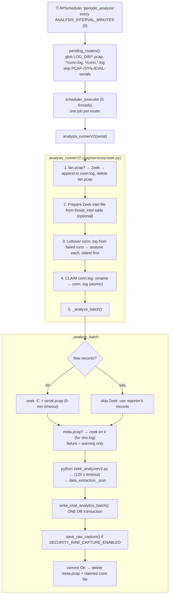
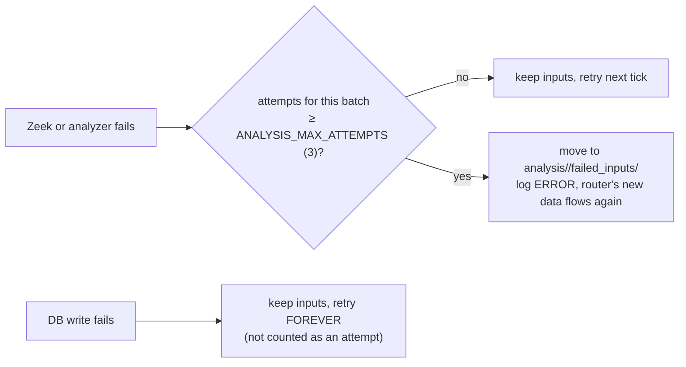
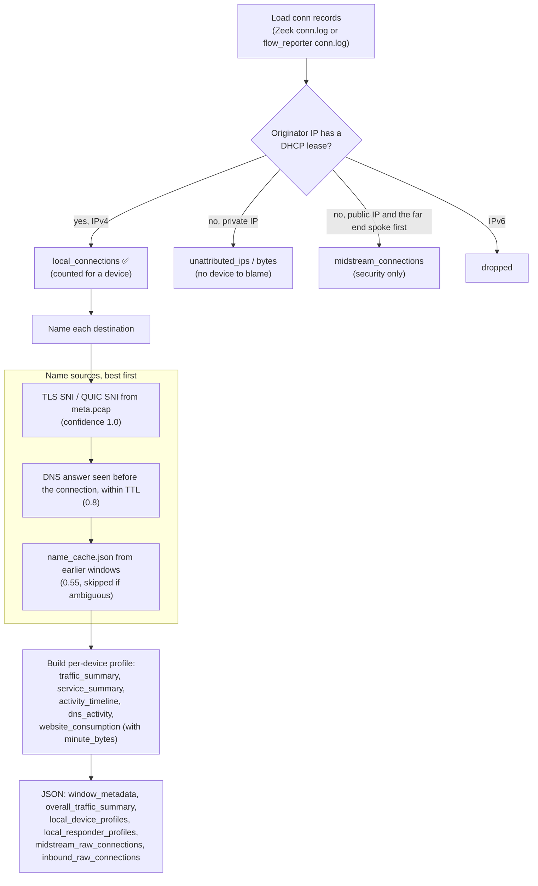
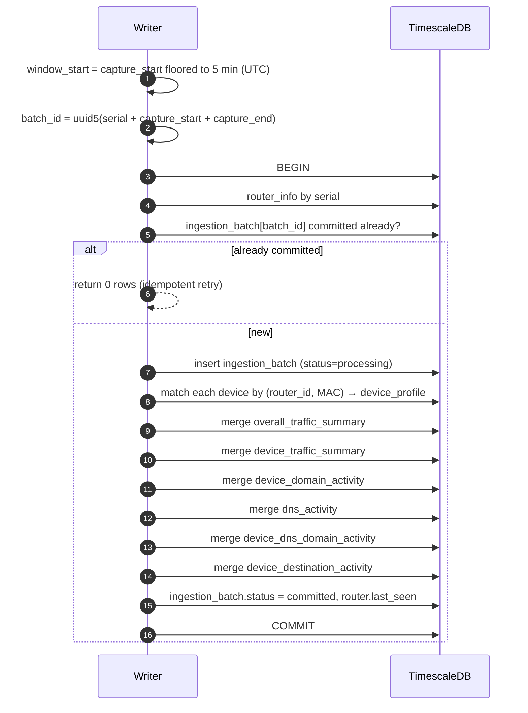

# 06 · Analysis pipeline (raw data → facts, every 5 minutes)

[← 05 · API endpoints](05-api-endpoints.md) · [Index](00-START-HERE.md) · **Next →** [07 · Database](07-database.md)

---

This is the heart of the system: how files on disk become rows in TimescaleDB.

## The files on disk (`LOG_DIR`)

`LOG_DIR` is **not** an env var. It is `BASE_DIR/logs` in [`app/core/constant.py`](../core/app/core/constant.py):
- running from a checkout: `core/logs/`
- **in Docker: `/tmp/logs`** (the image's working dir is `/tmp`; see [14 · Traps](14-traps-and-gotchas.md))

```
LOG_DIR/
  <serial>.pcap                    accounting pcap (old pcap mode, usually absent)
  <serial>/meta.pcap               names capture: DNS + TLS/QUIC handshakes
  <serial>/lan.pcap                device-to-device capture
  <serial>/conn.log                flow_reporter records (POST /flows)
  <serial>/conn.<epoch>.log        a "claimed" batch being analysed / left by a failed run
  <serial>/dhcp_leases.txt|.json   POST /dhcp
  <serial>/name_cache.json         IP → name memory between windows (24 h TTL)
  analysis/<serial>/               (= ANALYSIS_DIR)
     zeek_logs/ zeek_meta_logs/ zeek_lan_logs/ intel/
     data_extraction_<epoch>.json  analyzer output per window (never cleaned up)
     failed_inputs/<UTC>-<name>    inputs that failed 3 times
```

---

## One scheduler tick



### Why "claim by rename"?
The router keeps appending to `conn.log` while the analysis runs. Renaming first means new records go into a fresh file. Nothing is lost and nothing is counted twice.

### Failure handling



The attempt counter lives in memory, so it resets when the app restarts.

---

## The exact commands

**Zeek** ([`zeek.py::run_zeek`](../core/app/services/zeek.py)), with `cwd` set to the logs subdir:
```bash
/opt/zeek/bin/zeek -C -r <abs pcap> LogAscii::use_json=T local [<intel loader>]
```
(Zeek's path is hard-coded, so running outside Docker needs Zeek at `/opt/zeek`.)

**Analyzer** (`run_data_extractionV2`):
```bash
python app/utils/zeek_analyzerv2.py \
  --dhcp LOG_DIR/<serial>/dhcp_leases.json -o ANALYSIS_DIR/<serial>/data_extraction_<t>.json \
  [-d zeek_logs] [--conn <claimed conn file>] [--meta-logs zeek_meta_logs] \
  [--meta-pcap LOG_DIR/<serial>/meta.pcap] --name-cache LOG_DIR/<serial>/name_cache.json
```
Its timeout is `ANALYZER_TIMEOUT_SECONDS` (default 120).

---

## Inside the analyzer (`zeek_analyzerv2.py`)



Notes:
- **Why SNI comes from our own reader (`handshake_sni.py`) and not Zeek:** the router's filter keeps only handshake segments, so Zeek never sees a SYN and won't parse TLS. Modern browsers also split the QUIC ClientHello over several packets. Our reader parses TLS ClientHellos and **decrypts QUIC Initial packets** (public keys, RFC 9001; needs `cryptography`).
- **Streaming is not detected here.** The analyzer only records `minute_bytes` (downloaded bytes per minute per domain). The chat tool `get_streaming_sessions` works out sessions at query time.
- The analyzer runs its analysis twice (`generate_report` and `save_json`). It is wasteful but harmless.

---

## The writer (`chat_analytics_service.write_chat_analytics_batch`)



- **Idempotent:** the same capture always gets the same `batch_id`, so a retry cannot double-count.
- **Two captures in one 5-minute window are merged:** counts are summed and ratios recomputed. A row from the same batch is a no-op.
- **Devices are matched by MAC, never by hostname.** A device with no `device_profile` row is rejected (counted in `rejected_records`).

---

[← 05 · API endpoints](05-api-endpoints.md) · [Index](00-START-HERE.md) · **Next →** [07 · Database](07-database.md)
