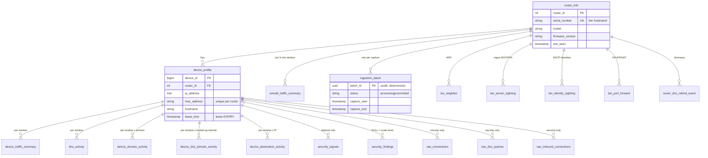
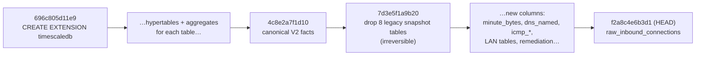

# 07 · Database (PostgreSQL + TimescaleDB)

[← 06 · Analysis pipeline](06-analysis-pipeline.md) · [Index](00-START-HERE.md) · **Next →** [08 · Chat agent](08-chat-agent.md)

---

## Quick mental model

- **`router_info`** is one row per router. `serial_number` is the "hostname".
- **`device_profile`** is one row per device (MAC) per router, filled from DHCP leases.
- **The 7 canonical facts** are the only analytics tables. Chat reads them, and security reads them too.
- **Security tables** hold signals, findings, raw per-connection rows and threat intel.
- **LAN tables** hold what the router itself sees: ARP, rogue DHCP, port forwards, rebinds, identities.

Every time-series table is a **TimescaleDB hypertable** on `ts` with 1-day chunks. `ts` is the **5-minute window start**.

The full meaning of every fact is in [`docs/chat-analytics-data-design.md`](../core/docs/chat-analytics-data-design.md).

---

## ER diagram (main relationships)



---

## The 7 canonical fact tables

| Table | Primary key | One row means... | Key columns |
|---|---|---|---|
| `overall_traffic_summary` | (router_id, ts) | the whole router in one 5-min window | total bytes and connections, `unattributed_devices`, `unattributed_bytes`, `active_device_count`, `attributed_bytes` |
| `device_traffic_summary` | (device_id, router_id, ts) | one device in one window (also the timeline) | bytes up/down, `upload_ratio`, `top_ports`, `first/last_activity`, `active_seconds`, `unattributed_destinations` |
| `dns_activity` | (device_id, router_id, ts) | one device's DNS in one window | `total_queries`, `unique_domains`, `failed_queries`, `query_types`, `response_codes` |
| `device_domain_activity` | (+ domain) | bytes one device exchanged with one **site** | `total_bytes`, `bytes_uploaded/downloaded`, `connection_count`, `attribution_source/confidence`, **`minute_bytes`** (per-minute downloads) |
| `device_dns_domain_activity` | (+ domain) | one device looking up one name | `query_count`, `response_codes`, `connected_ip_count`, `unfollowed_answer_count`, `private_answer_count`, `resolved_ips`, `max_answer_ttl` |
| `device_destination_activity` | (+ destination_ip) | one device talking to one **IP** | bytes, connections, `attributed_domain`, `dns_named`, `icmp_bytes/packets`, connection-time seconds |
| `ingestion_batch` | batch_id | one analysed capture | status, record counts, `quality` JSON |

All fact rows carry a `batch_id`, which makes retries idempotent.

### Continuous aggregates (pre-rolled summaries)

Each of the six detail and summary tables has `<table>_hourly` and `<table>_daily` continuous aggregates (12 in total, real-time, `materialized_only=false`).

> ⚠️ The **`_daily` views bucket by UTC day.** The chat agent **never reads them**. It reads the 5-minute base tables bucketed in the household `TIMEZONE`, or rolls `_hourly` into local days. That way "yesterday" means the household's yesterday.
>
> ⚠️ Backdated inserts (loading history) are not materialised by the refresh policies. Call `refresh_continuous_aggregate` afterwards.

### Retention and compression

| Tables | Compress after | Keep |
|---|---|---|
| `overall_traffic_summary`, `device_traffic_summary`, `dns_activity` | 7 days | forever |
| `device_domain_activity`, `device_dns_domain_activity`, `device_destination_activity` | 7 days | **90 days** |
| `raw_connections`, `raw_dns_queries`, `raw_inbound_connections` | 3 days | **30 days** |

---

## Security tables

| Table | PK | Purpose |
|---|---|---|
| `security_signals` | (device_id, router_id, ts, signal_type, entity) | One detector hit. `severity`, `score`, `details` JSONB, `triaged` flag |
| `security_findings` | id | What the customer may see: `verdict`, `severity`, `title`, `user_message`, `rationale`, `remediation`, `fingerprint`, `status` (active/resolved), `occurrences`, `pushed_at` |
| `threat_intel` | (indicator, kind) | Bad domains and IPs from abuse.ch (urlhaus, feodo) |
| `raw_connections` / `raw_dns_queries` / `raw_inbound_connections` | (id, ts) | Per-connection rows, written only if `SECURITY_RAW_CAPTURE_ENABLED` |

## LAN tables (from `POST /lan` and `/dhcp`)

| Table | What |
|---|---|
| `lan_neighbor` | ARP table: which MAC answered for which IP |
| `lan_server_sighting` | DHCP servers / IPv6 router adverts that are **not** the router (rogue) |
| `lan_identity_sighting` | hostname and client-id per MAC from lease lines (feeds MAC-spoofing detection) |
| `lan_port_forward` | UPnP mappings and static WAN port forwards (exposure) |
| `router_dns_rebind_event` | dnsmasq "possible DNS-rebind attack detected" lines |

---

## Migrations (Alembic)

- Config: [`alembic.ini`](../core/alembic.ini). [`alembic/env.py`](../core/alembic/env.py) reads `DATABASE_URL` from settings and swaps `+asyncpg` for psycopg2.
- **38 hand-written revisions in one straight line**, from `696c805d11e9` (enable timescaledb) to head `f2a8c4e6b3d1` (raw_inbound_connections).
- They run **automatically at app startup**, after `create_all`.



### How to add a migration

1. Add or change the model in `app/models/`. If it is a new module, also add it to the import list in `init_db()` in `app/core/db.py`.
2. With env vars set: `alembic revision -m "short_slug"`. **Write `upgrade()`/`downgrade()` by hand.** Don't trust `--autogenerate`: `env.py` imports stale model modules, and that import error is swallowed.
3. If it touches a table that has no model, guard it with `to_regclass(...)`.
4. Run `pytest app/tests/test_migration_chain.py` (checks one head, one base, no gaps, the guard rule).
5. Apply with `alembic upgrade head` or restart the app.
6. Raw-SQL inserts must supply **every NOT NULL column**: models only have Python-side defaults.

---

## Handy SQL to poke around

```sql
-- Which routers exist and when did they last send data?
SELECT router_id, serial_number, last_seen FROM router_info ORDER BY last_seen DESC;

-- Devices on a router
SELECT device_id, hostname, ip_address, mac_address, lease_time FROM device_profile WHERE router_id = 1;

-- Last hour of router-wide traffic
SELECT ts, total_bytes, unattributed_bytes FROM overall_traffic_summary
WHERE router_id = 1 AND ts > now() - interval '1 hour' ORDER BY ts;

-- Top sites today for a device
SELECT domain, sum(total_bytes) b FROM device_domain_activity
WHERE device_id = 5 AND ts > date_trunc('day', now()) GROUP BY domain ORDER BY b DESC LIMIT 10;

-- Did analysis batches commit?
SELECT status, count(*) FROM ingestion_batch GROUP BY status;
```

Connect locally with `psql -h localhost -p 5434 -U <user> <db>` (compose maps 5434 → 5432).

---

[← 06 · Analysis pipeline](06-analysis-pipeline.md) · [Index](00-START-HERE.md) · **Next →** [08 · Chat agent](08-chat-agent.md)
