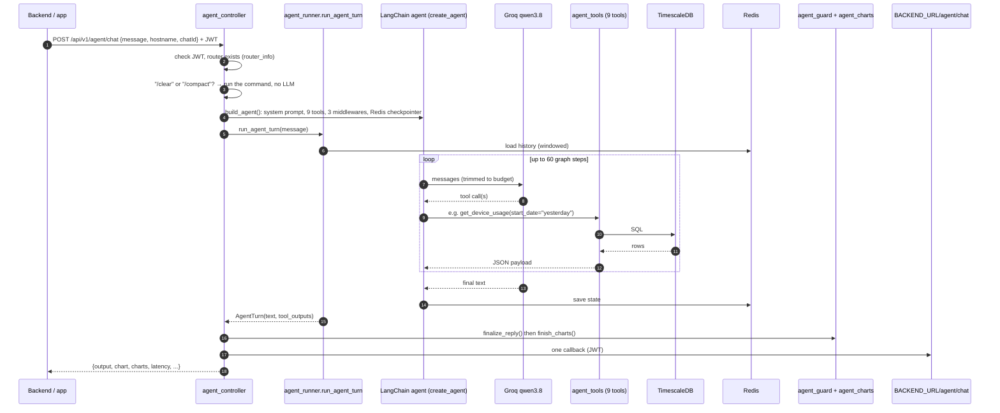
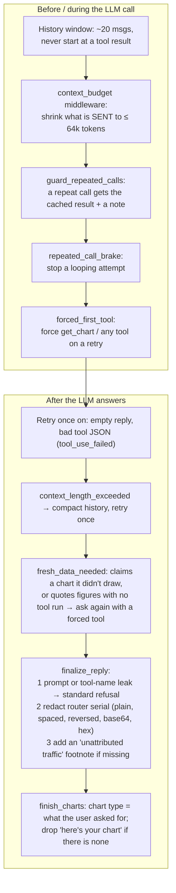
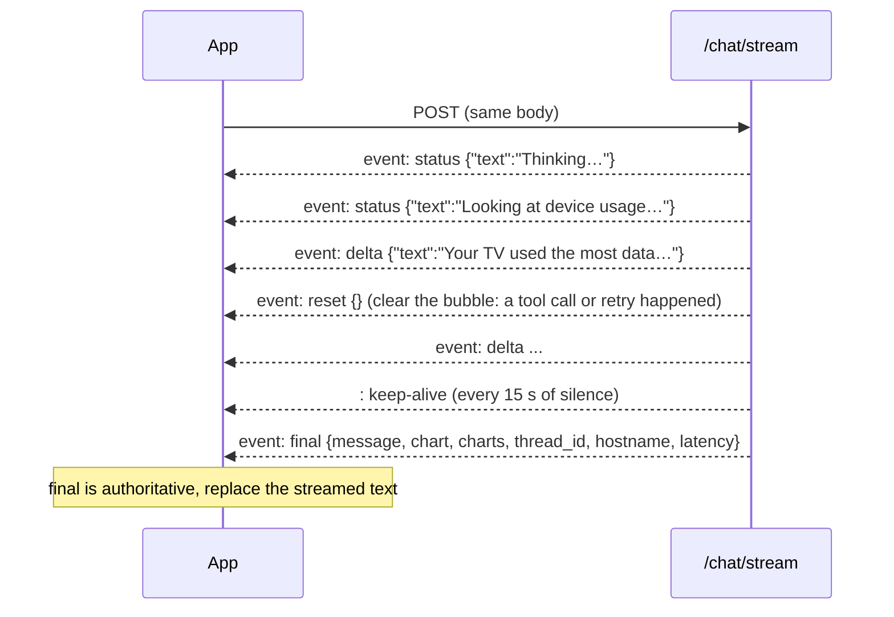

# 08 · Chat agent ("Talk to Data")

[← 07 · Database](07-database.md) · [Index](00-START-HERE.md) · **Next →** [09 · Security triage](09-security-triage.md)

---

## In easy words

The user types a question in the app. The backend forwards it here with a JWT. A **LangChain agent** (an LLM that can call functions) reads a long system prompt, picks one or more of **9 tools** that query TimescaleDB, and writes a short, mobile-friendly answer. Code then **guards** that answer (no leaks, no made-up charts) and returns it with chart specs. The app draws the chart. A copy goes to the backend.

- Model: **`qwen/qwen3.8-27b` on Groq** (`DEFAULT_MODEL`)
- Memory: **Redis** (LangGraph checkpointer), keyed `"<serial>:<chatId>"`
- Window: the last ~20 messages (`MAX_HISTORY_MESSAGES`), plus a size budget of 64k tokens

---

## The request path



Files:

| Step | File |
|---|---|
| HTTP + one callback | [`routes/agent_controller.py`](../core/app/routes/agent_controller.py) |
| Build agent, **system prompt**, Redis, windowing | [`services/agent_service.py`](../core/app/services/agent_service.py) |
| Run one turn, retries, repeated-call guard | [`services/agent_runner.py`](../core/app/services/agent_runner.py) |
| The 9 tools (SQL) | [`services/agent_tools.py`](../core/app/services/agent_tools.py) |
| Chart specs | [`services/agent_charts.py`](../core/app/services/agent_charts.py) |
| Reply guards | [`services/agent_guard.py`](../core/app/services/agent_guard.py) |
| Context budget, `/clear`, `/compact` | [`services/chat_context.py`](../core/app/services/chat_context.py) |
| Streaming (SSE) | [`services/agent_stream.py`](../core/app/services/agent_stream.py) |
| Langfuse tracing | [`services/chat_tracing.py`](../core/app/services/chat_tracing.py) |

---

## The 9 tools

Every tool takes `hostname` (the router serial) and resolves it to `router_id`.

| # | Tool | Answers questions like | Reads |
|---|---|---|---|
| 1 | `get_connected_devices` | "How many devices?", "Is the TV online?" (`device_count`, `seen_in_last_15_min`, `activity`, lease status) | `device_profile`, `device_traffic_summary`, `overall_traffic_summary` |
| 2 | `get_device_usage` | "Who used the most data yesterday?", "How long was X active?" (`period_totals`, `active_minutes`) | `device_traffic_summary` (5-min base table, local buckets) |
| 3 | `get_website_activity` | "Top websites this week", "Did anyone visit tiktok?" | `device_domain_activity` (+ `_hourly` for trends) |
| 4 | `get_recent_activity_timeline` | "What was happening after midnight?" | `device_traffic_summary` |
| 5 | `get_dns_activity` | "Did any website fail to load?" (`failed_lookups`) | `dns_activity`, `device_dns_domain_activity` |
| 6 | `get_router_overall_traffic_trends` | "How much internet did we use today?" (includes unattributed) | `overall_traffic_summary` |
| 7 | `get_destination_activity` | "Is a device connecting to something I don't recognise?" | `device_destination_activity` |
| 8 | `get_streaming_sessions` | "How long did the kids watch YouTube?" | `device_domain_activity.minute_bytes` |
| 9 | `get_chart` | "...as a pie chart" | calls tools 2, 3 and 6 internally; **numbers never pass through the LLM** |

---

## Protections around the model (why there is so much code)

The team learned the hard way that **prompt rules are requests, not guarantees**, so code enforces the important outcomes:



### Dates are parsed by code, not the model
`_parse_date_range()` in `agent_tools.py` understands `"yesterday"`, `"last weekend"`, `"this week"`, `"last month"`, `"3 days ago"`, `"2026-09-17"` and so on, in the household **`TIMEZONE`**. The prompt tells the model to pass the user's words through verbatim, because its own weekday arithmetic was often wrong.

### Units
Decimal: 1 GB = 1,000,000,000 bytes.

---

## Streaming endpoint (`/chat/stream`)

It runs the same turn but sends **Server-Sent Events**:



Text starts streaming only after 120 characters and always holds the last 64 back, so redaction can never be "overtaken". If the client disconnects, the turn still finishes and the callback is still sent.

---

## Chat commands

| Typed as the whole message, or the endpoint | Effect |
|---|---|
| `/clear` or `POST /chat/clear` | Delete the chat's history in Redis |
| `/compact` or `POST /chat/compact` | Keep only answered questions and their answers; drop tool data |

No LLM call is made. Typed as a message, the confirmation goes through the normal callback.

---

## Example

```bash
curl -s -X POST http://localhost:5000/api/v1/agent/chat \
  -H "Authorization: Bearer $TOKEN" -H "Content-Type: application/json" \
  -d '{"message":"Which device used the most data yesterday? pie chart","hostname":"RQ01000039","chatId":42}'
```
```json
{"output": "Your **Samsung-TV** used the most data yesterday, about 5.89 GB…",
 "thread_id": "42", "hostname": "RQ01000039", "latency": 3.41,
 "chart": {"type": "pie", "title": "Data used by device, Oct 11", "unit": "GB", "subject": "devices",
           "labels": ["Samsung-TV", "iPad"], "values": [5.89, 1.2], "granularity": null,
           "period": {"start": "...", "end": "..."}, "note": null},
 "charts": [ ... ], "metadata": { ... }}
```

---

## Things to remember when changing chat

- Payload timestamps go through `_local_iso` (household time), **not** `.isoformat()`.
- A new tool must be added to `TOOL_FUNCTIONS`, and its name must **not** be a common English word: the leak guard refuses any reply that names a tool.
- Wording in an instruction gets copied into answers. **Never write a sample answer you wouldn't want sent.**
- Measure changes with `scripts/eval/evaluate_chat.py` (see [13](13-testing-and-evaluation.md)). Deep reference: [`docs/agent-evaluation.md`](../core/docs/agent-evaluation.md) and [`docs/chat-analytics-data-design.md`](../core/docs/chat-analytics-data-design.md).

---

[← 07 · Database](07-database.md) · [Index](00-START-HERE.md) · **Next →** [09 · Security triage](09-security-triage.md)
