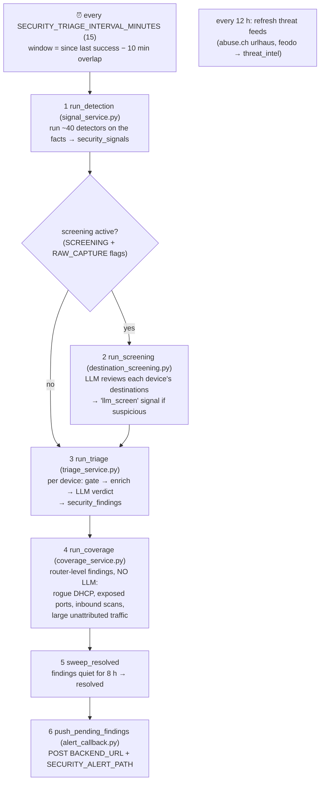
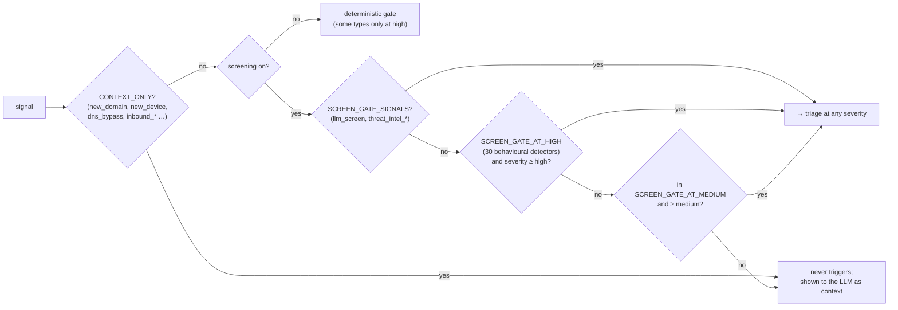
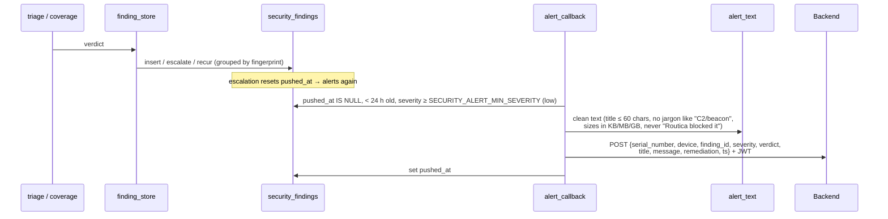

# 09 · Security triage ("Threat Detection")

[← 08 · Chat agent](08-chat-agent.md) · [Index](00-START-HERE.md) · **Next →** [10 · Config and credentials](10-config-and-credentials.md)

---

## In easy words

Every 15 minutes, simple **rules (detectors)** look at the same traffic facts chat uses and raise **signals** ("this laptop checked in with the same unknown server every 5 minutes for 3 hours"). Serious signals send the device to an **LLM triage**, which decides what it means and writes a plain sentence for the customer. That becomes a **finding**, which is pushed to the backend, which can notify the phone.

> **Design rule:** detectors decide **WHO** gets looked at, the LLM decides **WHAT IT MEANS**. The LLM can't lower a severity below a detector's floor.

The whole subsystem is **off by default**. Turn it on with `SECURITY_TRIAGE_ENABLED=True`. Before touching it, read [`docs/security-triage.md`](../core/docs/security-triage.md), the authoritative writeup.

---

## One security cycle

Code: [`app/services/security/scheduler.py`](../core/app/services/security/scheduler.py)

- Evaluation routers (`PCAP-*`, `SYN-*`, `EVAL-*`) are skipped.
- If a cycle is still running when the next is due, the skip is logged as an **ERROR**. A hung LLM call once froze detection for 2.6 days.
- Look for the log line `security cycle: N signals, N screened-in, …`.

---

## Detectors (signals), grouped

All in [`detectors.py`](../core/app/services/security/detectors.py). These are pure functions: values in, signal dicts out.

| Group | Signals | Plain meaning |
|---|---|---|
| **C2 / beaconing** | `beaconing`, `rotating_beacon`, `destination_relationship`, `site_rotation`, `web_service_c2`, `threat_intel_domain/ip`, `remote_access` | Malware "phoning home" on a regular rhythm; a known bad host; first use of a paste site or Telegram bot; a remote-control tool |
| **Download / exfiltration** | `payload_download`, `unnamed_upload`, `ip_check_contact`, `mail_ftp_exfil`, `upload_ratio`, `cumulative_exfil`, `volume_spike`, `unusual_hours` | Fetching an executable from a rented server; uploading lots of data to an unnamed host; odd-hour activity |
| **DNS tricks** | `new_domain` (context), `dga_domains`, `dns_failures`, `dns_txt_ratio`, `suspicious_tld`, `dns_bypass`, `anonymizer`, `dns_rebinding`, `fast_flux` | Machine-generated domains, DNS tunnelling, cheap TLDs, Tor, bypassing the router's DNS |
| **Scanning / brute force / floods** | `port_scan`, `dest_fanout`, `auth_service_abuse`, `web_fanout`, `spam_sending`, `flood`, `icmp_tunnel` | A device scanning, password-guessing, spamming or flooding |
| **LAN** | `internal_burst`, `arp_spoofing`, `mac_spoofing`, `new_device`, `device_silent` | Lateral movement, man-in-the-middle, identity tricks |
| **Inbound** (raw capture) | `inbound_scan`, `inbound_probe`, `inbound_flood` | The internet attacking an exposed device |
| **LLM** | `llm_screen` | The screening LLM thought this device looked wrong |

---

## The gate: which signals can wake the LLM?

All in [`triage_service.py`](../core/app/services/security/triage_service.py). **Every signal type must be in exactly one gate set**, which `test_gate_covers_every_detector.py` enforces.

Then a **6-hour triage cooldown** per device applies, bypassed for a new entity, an escalation, or a fresh medium-or-higher signal.

### Floors (the LLM cannot go below these)
- `SEVERITY_FLOOR_BY_SIGNAL`: e.g. `threat_intel_ip` → critical; `port_scan` → high; `payload_download` → medium.
- `VERDICT_FLOOR_SIGNALS`: a "benign" verdict over threat-intel, payload download, mail/FTP exfil or web-service C2 is raised to "suspicious".
- `ground_verdict`: an entity the LLM names that is not in the evidence is dropped, and the finding is capped at medium.

---

## Three ways a verdict is reached

| Mode | Flag | How |
|---|---|---|
| **One-shot triage** (default) | none | One LLM call with signals, 24 h of history and a behavioural profile; one retry if the JSON is bad |
| **Agentic investigator** | `SECURITY_AGENTIC_TRIAGE_ENABLED` | An LLM with **13 read-only tools** (threat intel, WHOIS/RDAP domain age, crt.sh, Spamhaus, baseline…) investigates step by step, then `submit_verdict(covers=…)`. 6-10 tool calls; must cover every required signal |
| **Destination screening** | `SECURITY_SCREENING_ENABLED` **and** `SECURITY_RAW_CAPTURE_ENABLED` | Not a judge: an LLM pre-screen per device that can send a device to triage with no detector firing |

Model: `SECURITY_TRIAGE_MODEL` (`qwen/qwen3.8-27b`) at temperature **0.1**, which keeps verdicts stable.

---

## From finding to phone

Push rules: verdict suspicious/malicious (or an unreviewed critical), and no repeat for the same fingerprint within 24 h.

**Read side:** `GET /api/v1/security/findings` (JWT) and the HTML pages `/security/alerts` and `/security/dashboard`.

---

## Security flags summary

| Flag | Default | Effect |
|---|---|---|
| `SECURITY_TRIAGE_ENABLED` | False | Start the security scheduler at all |
| `SECURITY_RAW_CAPTURE_ENABLED` | False | Write `raw_connections`/`raw_dns_queries`/`raw_inbound_connections`; needed by screening, inbound detectors and some arms |
| `SECURITY_SCREENING_ENABLED` | False | LLM pre-screen (needs raw capture too). **Changes the gate:** medium bands become context-only |
| `SECURITY_AGENTIC_TRIAGE_ENABLED` | False | Tool-using investigator instead of one prompt |
| `SECURITY_LLM_DETECTION_ENABLED` | True | Give triage the full behavioural profile |

---

## Headline numbers (for context only)

**Before quoting any number outside the team, read [`docs/security-benchmark.md`](../core/docs/security-benchmark.md).**
- On qwen3.8 over 3 runs: **42/43 compromised devices named at ≥ medium on every run (97.7%)**, 3/3 held-out captures, 0 benign findings.
- ATT&CK stage benchmark (latest, v7/v8): **151/165 development** and **171/192 test** stages every run. See [`docs/attack-benchmark.md`](../core/docs/attack-benchmark.md).
- Three corpus captures are **held out**: never tune on `remcos-rat-heldout`, `lumma-sectoprat-heldout`, `netsupport-stealc-heldout`.

---

[← 08 · Chat agent](08-chat-agent.md) · [Index](00-START-HERE.md) · **Next →** [10 · Config and credentials](10-config-and-credentials.md)
