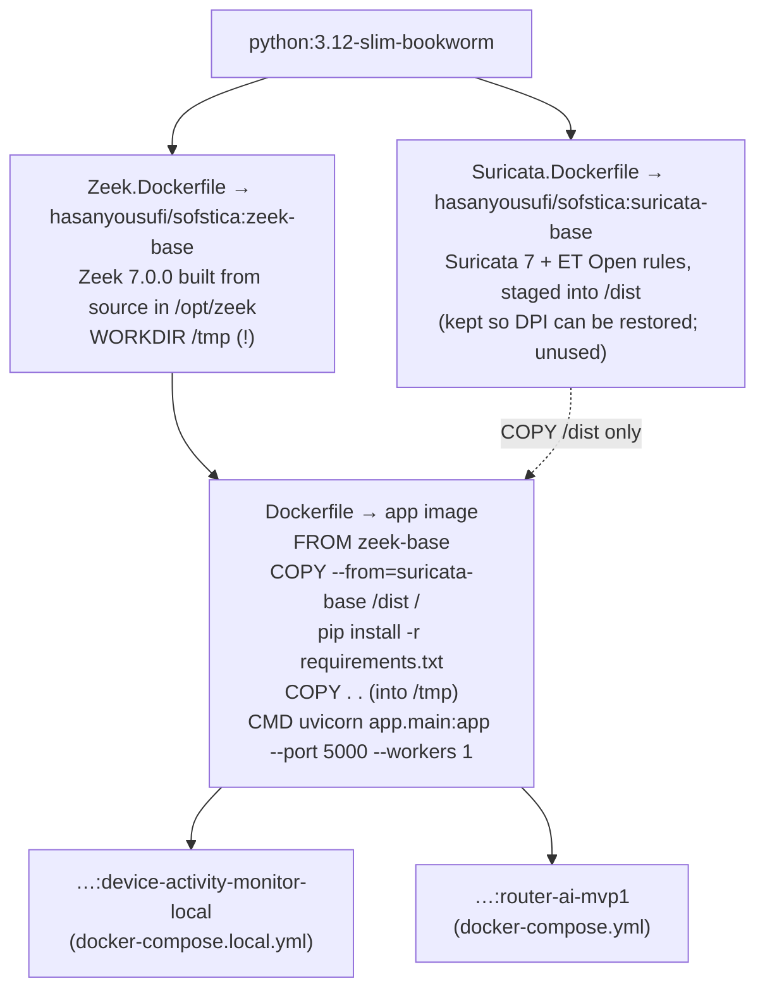
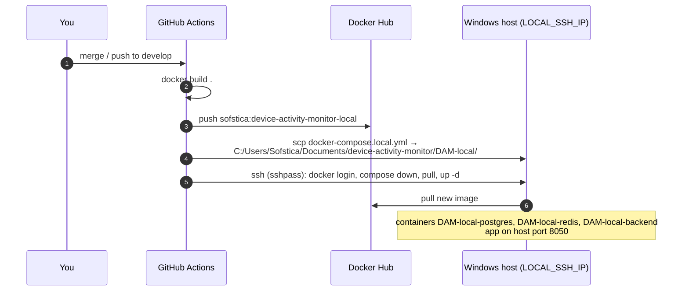

# 12 · Build, deploy and CI

[← 11 · Running locally](11-running-locally.md) · [Index](00-START-HERE.md) · **Next →** [13 · Testing and evaluation](13-testing-and-evaluation.md)

---

## Image chain

- Both base images use **the same upstream base** on purpose, so Suricata's shared libraries match.
- The `suricata -V` check in `Dockerfile` only **warns** on failure: the published suricata-base still predates a library fix, and the app hasn't used Suricata since 2026-09-28.
- **Because of `WORKDIR /tmp`, the app runs from `/tmp` and writes `/tmp/logs`.** The compose volume `./logs:/app/logs` is never used. See [14](14-traps-and-gotchas.md).

---

## GitHub workflows (`.github/workflows/`)

| Workflow | Trigger | Does | Secrets |
|---|---|---|---|
| `claude-pr-review.yml` | PR opened/synced/reopened; `@claude` in a comment | AI code review via a shared reusable workflow | `ANTHROPIC_API_KEY` |
| `local-release.yml` | push to **`develop`**, or manual dispatch | **build** image → push `…:device-activity-monitor-local`, then **deploy** over SSH | `LOCAL_DOCKER_USERNAME/PASSWORD`, `LOCAL_SSH_IP/USERNAME/PASSWORD` |
| `zeek-base-image.yml` | manual only | Build and push `zeek-base` | Docker creds |
| `suricata-base-image.yml` | manual only | Build and push `suricata-base` | Docker creds |

> ⚠️ **CI runs no tests and no lint.** Run `pytest` yourself before every PR.

### The deploy, step by step

What a redeploy means:
- `/tmp/logs` lives inside the container, so **DHCP lease files, the name cache and unclaimed flow records are lost on every redeploy**.
- Every backend restart drops the 10-second captures uploading at that moment.
- Base images change rarely. Rebuild them manually with their workflows when `Zeek.Dockerfile` or `Suricata.Dockerfile` changes.

---

## Git conventions

- Default branch: **`develop`** (local checkouts may be on `master`; PRs target `develop`).
- Branches: `ROUT-XXXX-short-description` (Jira key) or descriptive kebab-case.
- Commits: prefix `Feature:` / `Fix:` / `ci:`, subject < 72 chars. The body says the cause and what you verified. Keep unrelated changes in separate commits.
- PRs: scope, issue ID, sample `curl` output for API changes, the commands you ran, any config edits. Resolve conflicts and get the tests passing before requesting review.
- Docs: `*.md` is git-ignored, so use `git add -f docs/whatever.md`.

---

[← 11 · Running locally](11-running-locally.md) · [Index](00-START-HERE.md) · **Next →** [13 · Testing and evaluation](13-testing-and-evaluation.md)
