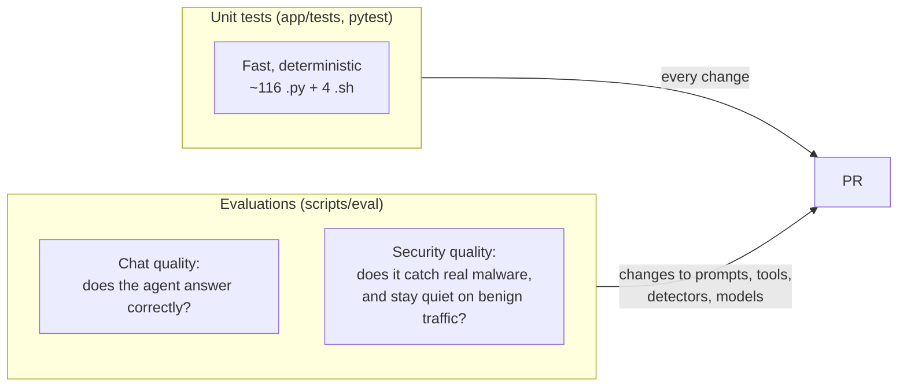
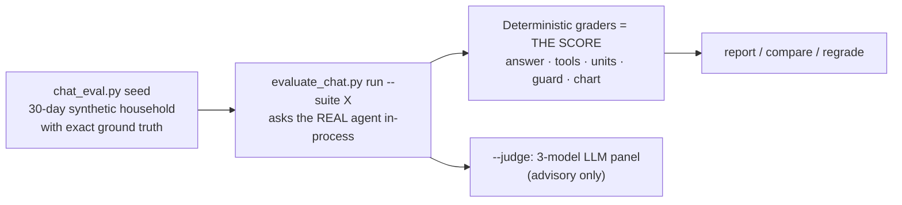
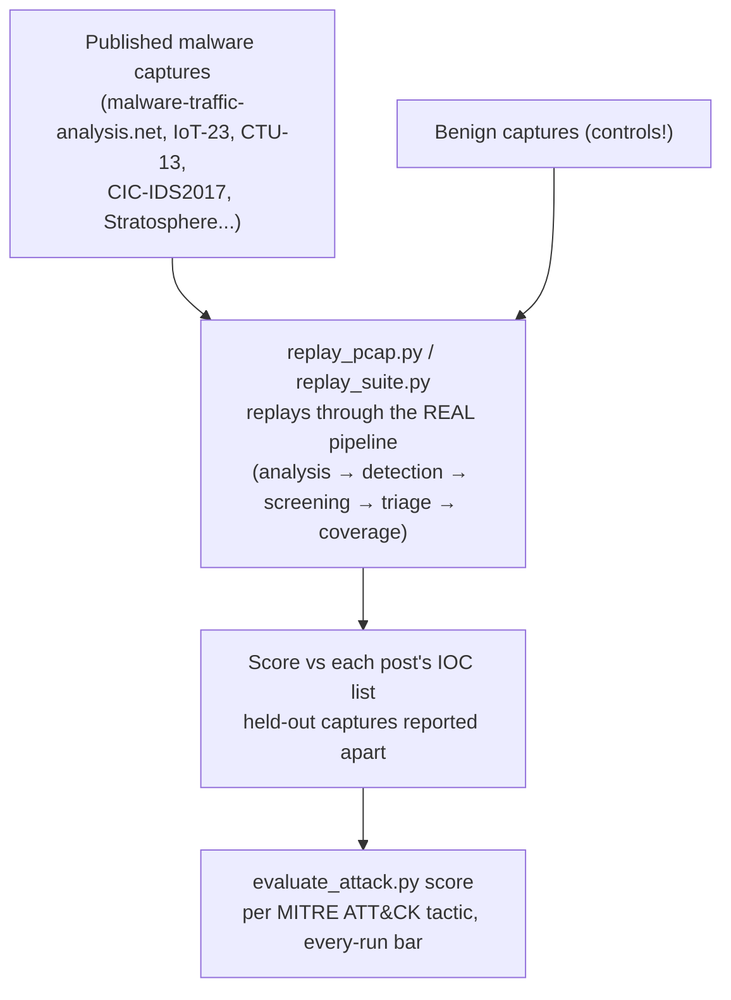

# 13 · Testing and evaluation

[← 12 · Build, deploy and CI](12-build-deploy-ci.md) · [Index](00-START-HERE.md) · **Next →** [14 · Traps and gotchas](14-traps-and-gotchas.md)

---

There are two very different kinds of checking:



---

## Unit tests

```bash
pip install pytest
export DATABASE_URL="postgresql+asyncpg://u:p@localhost:5432/x" REDIS_HOST=localhost \
       REDIS_PORT=6379 REDIS_PASSWORD=x BACKEND_URL= BACKEND_API_KEY=
pytest app/tests -q
pytest app/tests/test_agent_guard.py -q      # one file
```

- There is no `conftest.py` and no pytest config. Each test file puts the repo root on `sys.path` itself.
- Naming: `test_<unit>_<expectation>`. Bulky fixtures go in `app/tests/data/`.
- No CI runs them, so **you** must.

| Category | Examples |
|---|---|
| Chat agent and tools (~21) | `test_agent_guard`, `test_agent_runner`, `test_agent_charts`, `test_tool_date_filters`, `test_streaming_sessions`, `test_chat_context` |
| Chat eval pipeline (~14) | `test_chat_pipeline_*`, `test_chat_eval_*` |
| Ingest / analyzer / Zeek (~20) | `test_flow_ingest`, `test_handshake_sni`, `test_chat_analytics_v2`, `test_midstream_recovery`, `test_migration_chain` |
| Security detectors (~28) | `test_security_detectors`, `test_beacon_regularity`, `test_payload_download`, `test_gate_covers_every_detector` |
| Triage, findings, alerts (~25) | `test_security_triage`, `test_agentic_investigator`, `test_security_alert_text`, `test_infection_context` |
| Eval harness (~8) | `test_replay_pcap`, `test_replay_suite`, `test_attack_benchmark` |

### Tests that skip unless you set things up

| Need | Tests | How |
|---|---|---|
| Real Postgres | `test_device_identity`, `test_detection_arms_sql`, `test_signal_hygiene`, `test_finding_evidence`, `test_triage_signal_order`, `test_auth_service_abuse`, `test_security_finding_store`, `test_infection_context` | `ROUTICA_TEST_DATABASE_URL=...` (in the backend container: `ROUTICA_TEST_DATABASE_URL="$DATABASE_URL"`). They create and delete their own `PCAP-TEST-*` router |
| Production deps (Python 3.12 + `langgraph-checkpoint-redis`) | `test_agent_controller`, `test_agent_history_window`, `test_agent_prompt_reach`, `test_device_presence`, `test_security_findings_auth` | Run inside the backend image |
| busybox | `test_lan_reporter_script` | Install busybox |

**Shell tests** (not collected by pytest): `sh app/tests/test_capture_filter.sh`, `test_flow_reporter.sh`, `test_flow_reporter_sampling.sh`, `test_flow_reporter_signals.sh`.

---

## Chat evaluation

Guide: [`docs/agent-evaluation.md`](../core/docs/agent-evaluation.md). Run scripts **inside the backend container**: `docker exec <backend> sh -c 'cd /tmp && python scripts/eval/...'`.



| Command | What |
|---|---|
| `python scripts/eval/chat_eval.py seed --days 30 --host SYN-HOME-<MMDD>` | Seed the synthetic household |
| `python scripts/eval/evaluate_chat.py run --suite household --judge` | Suites: `household`, `context`, `guardrails`, `charts`, `qa`, `battery` (~1,390 turns) |
| `... run --suite battery --sample 100` | Random sample |
| `... report`, `compare`, `regrade`, `judge`, `calibrate` | Read, compare and re-grade stored runs |
| `scripts/eval/duration_eval.py seed` + `check --ask` | Streaming and active-time durations on flow-shaped data |
| `scripts/eval/live_eval.py --host <serial>` | ~13 questions on a live router, expected answers from its DB |
| `scripts/eval/injection_eval.py` | Prompt injection through device and site names |

Why deterministic graders are the score: an LLM judge's verdict moves from run to run, and **an eval whose own score moves cannot detect a regression**.

> Eval chat ids must be **random**. A thread keeps its history, and clock-derived ids from two scripts once collided.

---

## Security evaluation

Guides: [`docs/security-benchmark.md`](../core/docs/security-benchmark.md) (scoring rules; read before quoting numbers) and [`docs/attack-benchmark.md`](../core/docs/attack-benchmark.md) (per-ATT&CK-tactic benchmark).



| Script | Purpose |
|---|---|
| `replay_pcap.py --database-url … --pcap X` | One capture end to end (Langfuse trace) |
| `replay_suite.py --database-url … --repeat 3` | The 45-capture corpus in `replay_corpus.json` |
| `evaluate_attack.py catalog / label / presence / score` | ATT&CK stage benchmark |
| `generate_telemetry.py` + `replay_detection.py --database-url …` | Synthetic incidents with known truth (router `EVAL-SYNTH-01`) |
| `price_new_detectors.py --serial <s>` or `--corpus …` | Price a new detector on saved history: how often would it fire? No LLM |
| `lan_and_dns_e2e.py` | End-to-end check of the LAN/DNS detectors (exits 1 on failure) |
| `analyzer_ab.py --old … --new …` | Prove an analyzer change leaves chat facts unchanged |
| `suricata_baseline.py` | ET Open comparison |

Rules the team follows:
- **Benign controls matter most.** In a foreign capture every destination is unfamiliar, so a "catch" means nothing without a benign capture replayed the same way.
- **Never tune on held-out captures** (`remcos-rat-heldout`, `lumma-sectoprat-heldout`, `netsupport-stealc-heldout`).
- **Treat any single replay number as provisional until it has been run twice.** Fifteen harness bugs each once produced a confidently wrong number.
- ~2% of runs are decided by the shared Groq rate limit. Read a round's logs before quoting it.
- A full ATT&CK round (251 captures × 3) costs about **$75** and takes about **10 h** on one key.

---

[← 12 · Build, deploy and CI](12-build-deploy-ci.md) · [Index](00-START-HERE.md) · **Next →** [14 · Traps and gotchas](14-traps-and-gotchas.md)
