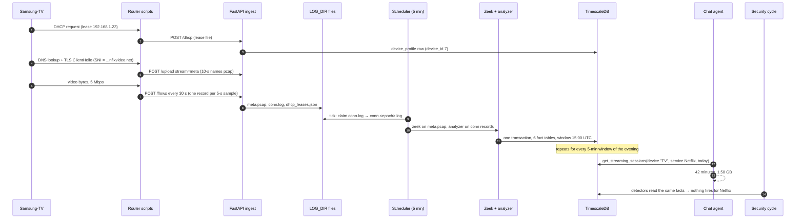

# 17 · README: one example, end to end (with every calculation)

[← 16 · Glossary and cheat sheet](16-glossary-and-cheatsheet.md) · [Index](00-START-HERE.md)

---

This page follows **one evening of one Samsung TV watching Netflix** through the whole system: router → API → disk → Zeek → analyzer → database → chat answer → security check. Every number is worked out at the step where it is created, using the real formulas from the code (file references are given at each step).

> The traffic numbers are invented, so the arithmetic stays readable. The **formulas, thresholds and field names are the real ones.** LLM text (the model's answer and the triage verdict) is illustrative, because a model's wording varies run to run.

---

## The cast

| Thing | Value |
|---|---|
| Router serial (the "hostname") | `RQ09990001` → `router_info.router_id = 3` |
| Household timezone | `TIMEZONE=Asia/Karachi` (UTC+5) |
| The TV | `Samsung-TV`, IP `192.168.1.23`, MAC `aa:bb:cc:dd:ee:01` → `device_profile.device_id = 7` |
| A guest phone | IP `192.168.1.99`, **static IP, no DHCP lease** (to show "unattributed") |
| Netflix server | `45.57.10.20:443`, server name `ipv4-c045-khi001-ix.1.oca.nflxvideo.net` |
| What happens | The TV plays Netflix from **20:00:55 to 20:42:55 local** (15:00:55–15:42:55 UTC) on **2026-10-13**, at a steady **5 Mbps**, with a 2-minute ad break at 20:20 |
| What the user asks at 21:00 | *"How long did the TV watch Netflix tonight, and how much data?"* |

## The whole journey on one diagram



---

## Step 0 · The TV joins the network (DHCP)

At 20:00:00 local (`epoch 1791903600`) the TV asks for an address. dnsmasq writes this line to `/tmp/dhcp.leases`:

```
1791990055 aa:bb:cc:dd:ee:01 192.168.1.23 Samsung-TV 01:aa:bb:cc:dd:ee:01
└expiry─┘  └──── MAC ─────┘  └── IP ───┘  └hostname┘ └── client id ──┘
```

The first field is the lease **expiry** (24 h from now), not the time it was granted. This is a known trap; see page 14.

`dhcp_monitor.sh` notices the file changed (it checks every 5 s) and sends it:

```bash
curl -X POST -F file=@/tmp/dhcp.leases -F hostname=RQ09990001 $ROUTICA_SERVER/dhcp
```

`POST /dhcp` (`router_file_controller.py`) then:
1. writes `LOG_DIR/RQ09990001/dhcp_leases.txt` (raw) and merges it into `dhcp_leases.json`:
   ```json
   {"192.168.1.23": {"mac": "aa:bb:cc:dd:ee:01", "hostname": "Samsung-TV",
                     "client_id": "01:aa:bb:cc:dd:ee:01", "lease_time": 1791990055}}
   ```
2. upserts `device_profile` **by MAC** (`device_profile_service.upsert_device_profiles`). Since this is a new MAC, it inserts:
   `device_id=7, router_id=3, ip_address=192.168.1.23, mac_address=aa:bb:cc:dd:ee:01, hostname=Samsung-TV, lease_time=2026-10-14 15:00:55+00`
3. upserts `lan_identity_sighting` (MAC + hostname + client id; used later by MAC-spoofing detection).

The guest phone has a static IP, so it **never appears in the lease file**. Remember that for Step 5.

---

## Step 1 · On the router: two collectors see the TV

### 1a. The names capture (`capture.sh`, `meta_*.pcap`)
At 20:00:54 the TV looks up the Netflix server. At 20:00:55 it opens TLS. The names capture keeps only DNS and TLS-handshake packets:

| Packet | Kept because | Useful content |
|---|---|---|
| DNS query and answer | `port 53` | `ipv4-c045-khi001-ix.1.oca.nflxvideo.net → 45.57.10.20`, TTL 300 |
| TLS ClientHello | `tcp port 443 and tcp[((tcp[12]&0xf0)>>2)]=22` (handshake record) | SNI = `ipv4-c045-khi001-ix.1.oca.nflxvideo.net` |
| The video itself | ❌ dropped by the filter | n/a |

Every 10 s (`-G 10`), tcpdump closes the file and runs `pcap_uploader.sh`, which posts it and then deletes it:
```bash
curl -X POST -F file=@/tmp/meta_2026-10-13_20-00-50.pcap -F hostname=RQ09990001 -F stream=meta $ROUTICA_SERVER/upload
```

### 1b. The flow reporter (`flow_reporter.sh`): the byte counts

Every **5 s** it reads the kernel's per-connection counters and writes one JSON line for each flow that moved bytes. The bytes are the **delta since the previous sample**.

**Calculation: bytes per 5-second sample at 5 Mbps**
```
download rate = 5 Mbps = 5,000,000 bits/s ÷ 8      = 625,000 bytes/s
per sample    = 625,000 bytes/s × 5 s              = 3,125,000 bytes   (resp = download)
upload        = ACKs and requests, say             =    40,000 bytes   (orig = upload)
```

The first sample after the connection opened (at 15:00:55 UTC) is taken at **15:01:00 UTC = epoch 1791903660**:

```json
{"ts": 1791903660, "uid": "F192.168.1.23:51544-45.57.10.20:443", "id.orig_h": "192.168.1.23", "id.orig_p": 51544,
 "id.resp_h": "45.57.10.20", "id.resp_p": 443, "proto": "tcp", "conn_state": "ESTABLISHED",
 "duration": 5, "flow_first_seen": 1791903655,
 "orig_bytes": 40000, "resp_bytes": 3125000, "orig_ip_bytes": 40000, "resp_ip_bytes": 3125000,
 "orig_pkts": 30, "resp_pkts": 2200, "local_orig": true, "local_resp": false, "missed_bytes": 0}
```

- `duration` = `now − first seen` = 1791903660 − 1791903655 = **5 s**. At the sample of 15:04:55 it would be 240 s. That is the flow's *age*, so **never add it up**.
- Each record is shaped like a Zeek `conn.log` line, so the analyzer can read either.

Every **30 s** the reporter uploads what it has collected: 30 ÷ 5 = **6 samples of this flow per upload**.
```bash
curl -X POST -H "Content-Type: application/x-ndjson" -H "X-Hostname: RQ09990001" --data-binary @/tmp/flow_reporter.acc $ROUTICA_SERVER/flows
```

The guest phone (`192.168.1.99`) also browses. Its records arrive the same way: 10 records in this 5-minute window, totalling 1,000,000 bytes up + 4,000,000 down = **5,000,000 bytes**.

---

## Step 2 · The API stores everything on disk (no database yet)

| Request | File written (`LOG_DIR` = `/tmp/logs` in Docker) | How |
|---|---|---|
| `POST /upload stream=meta` | `RQ09990001/meta.pcap` | The first file is kept whole. Later files are appended **minus their 24-byte pcap global header**, so it stays one valid pcap |
| `POST /flows` | `RQ09990001/conn.log` | Valid JSON lines are appended; malformed lines are dropped |
| `POST /dhcp` | `RQ09990001/dhcp_leases.json` | Merged (entries are never removed) |

For the window **15:00–15:05 UTC**, the TV's flow is sampled at 15:01:00, 15:01:05, … 15:04:55:
```
samples = (15:04:55 − 15:01:00) ÷ 5 s + 1 = 235 ÷ 5 + 1 = 48 records
```

---

## Step 3 · The scheduler picks the router up

APScheduler fires `periodic_analysis` every `ANALYSIS_INTERVAL_MINUTES = 5` (`app/services/scheduler.py`).

1. `pending_routers()` globs `LOG_DIR/*/conn.log` and finds `RQ09990001/conn.log`. The serial doesn't start with `PCAP-`, `SYN-` or `EVAL-`, so it is processed.
2. The job goes to the 5-thread pool and runs `analysis_runnerV2("RQ09990001")` (`app/services/zeek.py`).
3. **Claim by rename:** `conn.log` → `conn.1791903902.6.log` (the time of the claim). The router keeps appending to a *new* `conn.log`, so nothing is lost and nothing is counted twice.

> **Reality check:** the 5-minute tick runs relative to app start, not on clock boundaries, and uploads arrive every 30 s. A claimed file can therefore straddle two windows. It is stamped with the first window's `ts`, and a later capture landing in the same window is **merged** (Step 6). For readability, this example assumes the claimed file holds exactly the 48 samples of 15:01:00–15:04:55.

---

## Step 4 · Zeek and the SNI reader

The flow records need no Zeek: they're already conn-shaped. Only the names capture goes through Zeek:

```bash
/opt/zeek/bin/zeek -C -r LOG_DIR/RQ09990001/meta.pcap LogAscii::use_json=T local     # cwd: analysis/RQ09990001/zeek_meta_logs
```

| Output | What we get |
|---|---|
| Zeek `dns.log` | `ts 15:00:54, orig 192.168.1.23, query ipv4-c045-khi001-ix.1.oca.nflxvideo.net, answers [45.57.10.20], TTLs [300], rcode NOERROR` |
| Zeek `ssl.log` | **Nothing.** The filter dropped the SYN, so Zeek never sees a TCP handshake and won't parse TLS |
| `handshake_sni.py` (our own parser, `--meta-pcap`) | Finds the ClientHello bytes (`0x16 0x03 … type 1`) and reads SNI → `{ts 15:00:55, orig 192.168.1.23, resp 45.57.10.20, server_name ipv4-c045-…nflxvideo.net, source "ssl"}` |

Then the analyzer subprocess runs (timeout 120 s):
```bash
python app/utils/zeek_analyzerv2.py --dhcp LOG_DIR/RQ09990001/dhcp_leases.json \
  -o analysis/RQ09990001/data_extraction_1791903903.1.json \
  --conn LOG_DIR/RQ09990001/conn.1791903902.6.log --meta-logs analysis/RQ09990001/zeek_meta_logs \
  --meta-pcap LOG_DIR/RQ09990001/meta.pcap --name-cache LOG_DIR/RQ09990001/name_cache.json
```

---

## Step 5 · The analyzer turns records into a per-device profile

### 5a. Which device? (`load_data`, the lease filter)

| Record source | Has a lease? | Goes to | Effect |
|---|---|---|---|
| 192.168.1.23 (48 records) | ✅ in `dhcp_leases.json` | `local_connections` | Counted for **Samsung-TV** |
| 192.168.1.99 (10 records) | ❌ static IP | `unattributed_ips`, `unattributed_bytes` | `unattributed_devices = 1`, `unattributed_bytes = 5,000,000` |

### 5b. Which site? (`DNSEnricher.get_domains_for_ip`)

For each TV record, names are tried in priority order:

```
1) SNI for (192.168.1.23 → 45.57.10.20)?
   SNI seen at 15:00:55.  First record at 15:01:00 → |Δt| = 5 s ≤ SNI_MATCH_WINDOW (900 s) ✓
   Last record at 15:04:55 → |Δt| = 240 s ≤ 900 s ✓
   → domain = ipv4-c045-khi001-ix.1.oca.nflxvideo.net, source = tls_sni, confidence = 1.0
2) (DNS would also have matched: query at 15:00:54, TTL 300 s, the last record is 241 s later ≤ 300 ✓
   → dns_named = true. Security uses this flag: "DNS alone would have named it".)
```

### 5c. Bytes (`wire_bytes` uses `*_ip_bytes`)

```
bytes_downloaded = 48 × 3,125,000 = 150,000,000 bytes  (150.0 MB)
bytes_uploaded   = 48 ×    40,000 =   1,920,000 bytes  (  1.9 MB)
total_bytes      = 150,000,000 + 1,920,000 = 151,920,000 bytes
upload_ratio     = 1,920,000 ÷ 151,920,000 = 0.012638… → round(…, 4) = 0.0126
```

### 5d. Per-minute downloads (`add_minute_bytes`, used for streaming time)

A flow sample goes wholly into the minute of its `ts` (`epoch // 60`):

| UTC minute | epoch minute key | samples | downloaded |
|---|---|---|---|
| 15:01 | 29865061 | 12 (`:00 … :55`) | 12 × 3,125,000 = **37,500,000** |
| 15:02 | 29865062 | 12 | 37,500,000 |
| 15:03 | 29865063 | 12 | 37,500,000 |
| 15:04 | 29865064 | 12 | 37,500,000 |
| **sum** | | 48 | **150,000,000** ✓ matches 5c |

### 5e. Time (`connection_seconds`, `total_activity_duration_seconds`)

```
connection time to 45.57.10.20 (flow counted once, by uid):
  first sample 15:01:00, last 15:04:55, flow_first_seen 15:00:55
  = last − max(flow_first_seen, first − 5 s) = 15:04:55 − max(15:00:55, 15:00:55) = 240 s
device active span = last record − first record = 15:04:55 − 15:01:00 = 235 s
```
(Summing `duration` instead would give 5+10+…+240 = 48 × 122.5 = 5,880 s ≈ 98 min for 4 minutes of video. This is exactly the bug the team fixed.)

### 5f. Window and router totals

```
window_metadata.window_start = min(ts of lease-owned records) = 15:01:00Z
window_metadata.window_end   = max(ts)                        = 15:04:55Z
overall_traffic_summary.total_bytes = Σ device total_bytes    = 151,920,000   ← known devices ONLY
overall_traffic_summary.unattributed_bytes                    =   5,000,000   ← the guest phone
```

### 5g. Output (`data_extraction_*.json`, trimmed)

```json
{"window_metadata": {"window_start": "2026-10-13T15:01:00+00:00", "window_end": "2026-10-13T15:04:55+00:00",
                     "total_local_devices": 1, "total_connections": 48},
 "overall_traffic_summary": {"total_bytes": 151920000, "unattributed_devices": 1, "unattributed_bytes": 5000000},
 "local_device_profiles": [{
   "originator_ip": "192.168.1.23",
   "device_identity": {"mac_address": "aa:bb:cc:dd:ee:01", "hostname": "Samsung-TV"},
   "traffic_summary": {"total_connections": 48, "total_bytes": 151920000, "bytes_uploaded": 1920000,
                       "bytes_downloaded": 150000000, "upload_ratio": 0.0126, "external_connections": 48},
   "service_summary": {"unique_ports": 1, "failed_connections": 0, "top_ports": [{"port": 443, "connections": 48}]},
   "activity_timeline": {"total_activity_duration_seconds": 235.0,
     "all_destinations": [{"destination_ip": "45.57.10.20", "total_bytes": 151920000, "connection_count": 48,
        "attributed_domain": "ipv4-c045-khi001-ix.1.oca.nflxvideo.net", "dns_named": true,
        "total_connection_time_seconds": 240.0}]},
   "website_consumption": {"top_websites": [{"domain": "ipv4-c045-khi001-ix.1.oca.nflxvideo.net",
        "total_bytes": 151920000, "bytes_uploaded": 1920000, "bytes_downloaded": 150000000, "connection_count": 48,
        "attribution_source": "tls_sni", "attribution_confidence": 1.0, "is_ambiguous": false,
        "minute_bytes": {"29865061": 37500000, "29865062": 37500000, "29865063": 37500000, "29865064": 37500000}}]},
   "dns_activity": {"total_queries": 1, "failed_queries": 0, "top_domains": [{"domain": "ipv4-c045-…nflxvideo.net",
        "resolved_ips": ["45.57.10.20"], "max_answer_ttl": 300}]}}]}
```

> ⚠️ **What the example shows about the code:** `total_connections` and `connection_count` are **48**, but it is **one** TCP connection. For flow-reporter data, every 5-s sample counts as a "connection". Bytes and time are right (they were fixed); connection *counts* are inflated by the sample rate. Keep this in mind before quoting "connections" anywhere.

---

## Step 6 · The writer stores facts (`chat_analytics_service.write_chat_analytics_batch`)

### 6a. Window and batch id
```
window_start = floor(15:01:00Z to a 5-min boundary) → minute 1 − (1 mod 5) = 0  → 2026-10-13 15:00:00Z   (= ts of every row)
window_end   = window_start + 5 min                                              → 2026-10-13 15:05:00Z
batch_id     = uuid5(8621574e-9874-4cef-9aa4-cbe0916f37b7,
                     "analysis_runner_v2:RQ09990001:2026-10-13T15:01:00+00:00:2026-10-13T15:04:55+00:00")
             = bf045a60-65b2-52c0-8fcf-6f765a015c52
capture span = 235 s ≤ 300 s → no "capture_spans_multiple_windows" warning
```
If this batch is retried (e.g. the DB was down), the **same** id comes out, `ingestion_batch` already says `committed`, and nothing is written twice.

### 6b. Device match
The profile's MAC `aa:bb:cc:dd:ee:01` + `router_id 3` → `device_profile.device_id = 7` ✓. (Without the Step 0 lease, the profile would be rejected, and the bytes would exist only as the "unattributed" total.)

### 6c. The rows (all with `ts = 2026-10-13 15:00:00+00`, `batch_id = bf045a60…`)

| Table | Key | Values written |
|---|---|---|
| `overall_traffic_summary` | router 3 | total_bytes **151,920,000** · unattributed_devices **1** · unattributed_bytes **5,000,000** · active_device_count 1 · attributed_bytes 151,920,000 |
| `device_traffic_summary` | device 7 | total_bytes 151,920,000 · up 1,920,000 · down 150,000,000 · upload_ratio 0.0126 · total_connections 48 · top_ports [{443: 48}] · first/last_activity 15:01:00/15:04:55 · active_seconds **235** · unattributed_destinations 0 |
| `device_domain_activity` | device 7 · `ipv4-c045-…nflxvideo.net` | total_bytes 151,920,000 · connection_count 48 · attribution tls_sni / 1.0 · **minute_bytes** {29865061…29865064: 37,500,000 each} |
| `dns_activity` | device 7 | total_queries 1 · failed_queries 0 · response_codes {NOERROR: 1} |
| `device_dns_domain_activity` | device 7 · same name | query_count 1 · resolved_ip_count 1 · connected_ip_count 1 · unfollowed_answer_count 0 · private_answer_count 0 · resolved_ips ["45.57.10.20"] · max_answer_ttl 300 |
| `device_destination_activity` | device 7 · 45.57.10.20 | total_bytes 151,920,000 · connection_count 48 · attributed_domain …nflxvideo.net · dns_named true · total_connection_time_seconds **240** |
| `ingestion_batch` | bf045a60… | status committed · window 15:00–15:05 · accepted_records = 1 + (1 device + 1 domain + 1 dns-domain + 1 destination) = **5** |

After the commit, the claimed `conn.1791903902.6.log` and `meta.pcap` are deleted. **They are only deleted after the commit succeeds.**

---

## Step 7 · The rest of the evening

The same thing happens for every window from 15:00 to 15:40 UTC: **9 windows**, so 9 rows per table for the TV. The per-minute picture after all of them:

| Local time | UTC minutes | Bytes per minute | Note |
|---|---|---|---|
| 20:01–20:19 | 15:01–15:19 | 37,500,000 each (19 min) | movie |
| 20:20–20:21 | 15:20–15:21 | 500,000 each (2 min) | ad break: the player barely downloads |
| 20:22–20:42 | 15:22–15:42 | 37,500,000 each (21 min) | movie |

> In later windows the ClientHello at 20:00:55 is more than 900 s old, so SNI from *this* batch no longer matches. If the TV opened no new TLS connection, the name comes from `name_cache.json` (saved after earlier batches, 24 h validity) as **source `cache`, confidence 0.55**, and is skipped if several names compete. Netflix normally opens new connections, so the SNI is usually seen again.

---

## Step 8 · Chat: "How long did the TV watch Netflix tonight, and how much data?"

### 8a. Request (from the backend)
```http
POST /api/v1/agent/chat
Authorization: Bearer <HS256 JWT, key = base64-decoded BACKEND_API_KEY, exp required>
{"message": "How long did the TV watch Netflix tonight, and how much data?", "hostname": "RQ09990001", "chatId": 42}
```
Checks: JWT valid ✓ · message ≤ 2,000 chars ✓ · `RQ09990001` in `router_info` ✓ · not `/clear` or `/compact` ✓.

### 8b. What the model is given (`agent_service.build_agent`)
- **System prompt** (~18k tokens with the tool definitions). The dynamic bits, filled in now, include:
  - current local time `2026-10-13 21:00 (Asia/Karachi)`
  - the last 15 dates with weekdays (`Tue 2026-10-13`, `Mon 2026-10-12`, …)
  - the router's first day of data
- **History:** Redis thread `RQ09990001:42`, last ≤ 20 messages (empty for a new chat)
- **Tools:** the 9 tools, each wrapped by `guard_repeated_calls`
- **Middlewares:** `repeated_call_brake`, `context_budget` (≤ 64,000 tokens sent), `forced_first_tool`

### 8c. The model's tool call
```json
{"name": "get_streaming_sessions",
 "args": {"hostname": "RQ09990001", "device_name": "TV", "service": "Netflix", "start_date": "today"}}
```
"Tonight" isn't a named period. The prompt teaches the model to pass "today", and to pass words through rather than compute dates itself.

### 8d. Inside the tool: every calculation (`agent_tools.get_streaming_sessions`)

**Device name → device** (`_find_device`):
```
"TV": exact hostname? ✗ · case/punctuation-insensitive match? "tv" ≠ "samsungtv" ✗
      contained in exactly ONE device's hostname? "tv" ⊂ "samsung-tv" ✓ (one match) → device_id 7
```

**Date → UTC range** (`_parse_date_range`, in `TIMEZONE`):
```
"today" = local midnight 2026-10-13 00:00 +05:00 = 2026-10-12 19:00:00Z  → WHERE ts >= '2026-10-12 19:00Z'
(no end given → no upper bound)
```

**The threshold for "watching":**
```
min_bytes_per_minute = STREAMING_MIN_KBPS × 1000 ÷ 8 × 60 = 250 × 1000 ÷ 8 × 60 = 1,875,000 bytes/min
```

**The SQL** expands every row's `minute_bytes` JSON into (minute, bytes) pairs. The name `ipv4-c045-…nflxvideo.net` contains `nflxvideo.net`, so it is **Netflix** (`STREAMING_SERVICES`).

**Session merge** (`_merge_streaming_sessions`, gap = 2 min, min length = 2 min):
```
minutes ≥ 1,875,000:   15:01 … 15:19  (19 min)   and   15:22 … 15:42  (21 min)
ad break:              15:20, 15:21 at 500,000  → below threshold, not "active"
gap check:             15:22 − 15:19 = 180 s ;  split only if > (gap_minutes + 1) × 60 = 180 s  → 180 is NOT > 180 → bridged
one session:           15:01 → 15:42
length:                (15:42 − 15:01) ÷ 60 + 1 = 41 + 1 = 42 minutes      (a minute bucket covers the minute it starts)
bytes:                 every minute in range: 40 × 37,500,000 + 2 × 500,000 = 1,500,000,000 + 1,000,000 = 1,501,000,000
42 ≥ STREAMING_MIN_MINUTES (2) ✓ kept
```

**Payload returned to the model** (times rendered in local time by `_json_default`):
```json
{"hostname": "RQ09990001", "router_id": 3,
 "period": {"start_date": "2026-10-13T00:00:00+05:00", "end_date": null, "covers": "requested range"},
 "detection": {"min_kbps": 250, "gap_minutes": 2, "basis": "Minutes where the device sustained a media-sized download from the service. Streaming activity, not proof anyone watched."},
 "totals_by_service": {"Netflix": {"minutes": 42, "sessions": 1, "bytes": 1501000000}},
 "totals_by_device": {"Samsung-TV": {"Netflix": {"minutes": 42, "sessions": 1, "bytes": 1501000000}}},
 "sessions": [{"device_id": 7, "device": "Samsung-TV", "service": "Netflix",
               "start": "2026-10-13T20:01:00+05:00", "end": "2026-10-13T20:42:00+05:00",
               "duration_minutes": 42, "bytes": 1501000000}]}
```

### 8e. The model writes the answer (illustrative)
```
bytes → GB (decimal, as the prompt requires): 1,501,000,000 ÷ 1,000,000,000 = 1.501 → "about 1.5 GB"
```
> Your **Samsung-TV** streamed Netflix for about **42 minutes** tonight (8:01 PM – 8:42 PM), using about **1.5 GB** of data.

### 8f. Code checks the answer
| Step | Check | Result here |
|---|---|---|
| `fresh_data_needed` | Claims a chart without one? Figures with no tool run? | No: a tool ran |
| `finalize_reply` 1 | Leaks a prompt phrase or tool name? | No |
| `finalize_reply` 2 | Router serial in any form (plain, spaced, reversed, base64, hex)? | No |
| `finalize_reply` 3 | A tool returned `period_totals.unattributed_bytes > 0` and the reply doesn't mention it? | No `period_totals` in this payload, so no footnote |
| `finish_charts` | Charts drawn by `get_chart`? | None asked, so `charts: []` |

### 8g. Out the door
- **One callback**: `POST {BACKEND_URL}/agent/chat` with a fresh JWT (`sub: routica-backend`, expires in 300 s) and `{message, hostname, chatId: 42, chart: null, charts: []}`.
- **Response:**
```json
{"output": "Your **Samsung-TV** streamed Netflix for about **42 minutes** tonight…", "thread_id": "42",
 "hostname": "RQ09990001", "latency": 3.4, "chart": null, "charts": [], "metadata": {"model_name": "qwen/qwen3.8-27b"}}
```

---

## Step 9 · A follow-up that triggers the "unattributed" footnote

*"How much data did the whole house use between 8:00 and 8:05 pm?"* → `get_router_overall_traffic_trends(start_date="2026-10-13T20:00", end_date="2026-10-13T20:05")`

```
range: 20:00 → just before 20:05 local = 15:00:00Z ≤ ts < 15:05:00Z   (a clock-time end excludes that minute's window)
rows:  the 15:00 window only
period_totals (via _with_unattributed):
  total_bytes (known devices)  = 151,920,000                 → "151.9 MB"
  unattributed_bytes           =   5,000,000                 → "5.0 MB"
  whole_network_total_bytes    = 151,920,000 + 5,000,000 = 156,920,000  → "156.9 MB"
  share                        = round(100 × 5,000,000 ÷ 156,920,000) = round(3.19) = 3 %
  note: "total_bytes (151.9 MB) counts known devices only. A further 5.0 MB (3% of the whole network's 156.9 MB)
         came from 1 device(s) with no DHCP lease … Say so whenever you quote the total."
```
If the model replies only "About 151.9 MB" and doesn't mention the gap, `finalize_reply` appends:
> *Note: about 5.0 MB of this traffic came from devices with no DHCP lease, so it isn't tied to any known device.*

---

## Step 10 · The same facts through Threat Detection

(With `SECURITY_TRIAGE_ENABLED=True` the cycle runs every 15 min: `run_detection → run_triage → run_coverage → sweep_resolved → push_pending_findings`.)

### 10a. The real evening: nothing fires, and that's correct

| Detector | Its test | TV + Netflix | Fires? |
|---|---|---|---|
| `beaconing` | ≥ 12 windows, ≥ 6 conns, **≤ 4,096 bytes per conn**, ≤ 2 devices | 151,920,000 ÷ 48 = **3,165,000 bytes/conn** ≫ 4,096 | ❌ |
| `payload_download` | 50 KB+ over **plain HTTP** from an unnamed rented server | port 443, named by SNI and DNS | ❌ |
| `upload_ratio` | ≥ 80 % upload and ≥ 10 MB | 1.26 % | ❌ |
| `new_domain` | Parent not seen in 30 days | maybe, if Netflix is new to this home | context-only, **never triggers triage** |
| routine check | ≥ 2 devices on ≥ 3 of 30 days | nflxvideo.net on several devices | trusted |

No actionable signal means no LLM call and no finding. Cost: zero tokens.

### 10b. What-if: the TV also has a hidden check-in

Suppose that during the same 3 hours the TV also sends **600 bytes every 5 minutes** to `203.0.113.50:8443`, an address no DNS lookup ever named.

**Detector math** (`detect_beaconing`, constants in `detectors.py`):
```
windows_seen       = 3 h × 12 windows/h            = 36   ≥ BEACON_MIN_WINDOWS (12)        ✓
total_connections  = 36                                   ≥ BEACON_MIN_CONNECTIONS (6)     ✓
bytes_per_conn     = (36 × 600) ÷ 36               = 600  ≤ BEACON_MAX_BYTES_PER_CONN (4096) ✓
device_prevalence  = 1 device                             ≤ BEACON_MAX_PREVALENCE (2)      ✓
internet unicast?  203.0.113.50                           ✓ (not LAN, not multicast)
severity           = 36 ≥ BEACON_HIGH_WINDOWS (30) → "high"
rhythm             = interval_cv 0.04 ≤ BEACON_MAX_CV (0.6) → stays "high"
known service?     no → no down-rank
```
→ a `security_signals` row: `(device 7, router 3, ts, "beaconing", "203.0.113.50")`, severity **high**, score 36, details `{windows_seen: 36, bytes_per_connection: 600.0, device_prevalence: 1, interval_cv: 0.04}`. Duplicates are suppressed for 6 h (`SECURITY_SIGNAL_COOLDOWN_HOURS`).

**Gate** (`triage_service.is_actionable`, screening off): `beaconing` may open triage **only at high**. Severity is high ✓ → device 7 goes to triage. No 6-h triage cooldown applies (first time).

**Triage prompt** (one LLM call, `qwen/qwen3.8-27b`, temperature 0.1): the untriaged signals (≤ 50, actionable first), 24 h of earlier findings, the TV's behavioural profile ("now vs normal"), and enrichment added now (who owns `203.0.113.50`, its reverse-DNS name, whether it is in threat intel or the household routine).

**Verdict (illustrative)** and what code does to it:
```json
{"verdict": "suspicious", "severity": "medium", "confidence": 0.7,
 "title": "Samsung-TV keeps contacting an unknown server",
 "user_message": "Your Samsung-TV has contacted an unfamiliar server every 5 minutes for 3 hours, sending tiny amounts of data…",
 "remediation": ["Check for a TV software update", "Remove apps you don't recognise"]}
```
| Safeguard | Effect here |
|---|---|
| `ground_verdict` | Named entity `203.0.113.50` is in the evidence ✓ kept |
| `apply_verdict_floor` | `beaconing` isn't a verdict-floor signal → "suspicious" stands |
| `apply_severity_floor` | `beaconing` has no floor → "medium" stands (`threat_intel_ip` would force critical) |

**Store and push:** `finding_store.upsert_finding` creates one row (grouped by fingerprint, `status=active`). `push_pending_findings`: verdict suspicious ✓, severity medium ≥ `SECURITY_ALERT_MIN_SEVERITY` (low) ✓, not pushed in the last 24 h ✓. `alert_text` cleans the title (≤ 60 chars, no "beacon"/"C2"):
```json
POST {BACKEND_URL}/api/v1/notifications/security-alert
{"serial_number": "RQ09990001", "device": {"hostname": "Samsung-TV", "mac_address": "aa:bb:cc:dd:ee:01", "ip_address": "192.168.1.23"},
 "finding_id": 1, "severity": "medium", "verdict": "suspicious", "title": "Samsung-TV keeps contacting an unknown server",
 "message": "…", "remediation": ["…"], "unreviewed": false, "ts": "…"}
```
If it keeps happening, the same finding's `occurrences` and `last_seen` go up (no new alert). If it stops for 8 h (`SECURITY_RESOLVE_AFTER_HOURS`), the finding is swept to `resolved`.

---

## The whole calculation chain in one table

| Stage | Number | How it was produced |
|---|---|---|
| Line rate | 5 Mbps | the TV |
| Router sample | 3,125,000 B per 5 s | 625,000 B/s × 5 s (`flow_reporter.sh`) |
| One window | 48 records | (15:04:55 − 15:01:00) ÷ 5 + 1 |
| Window download | 150,000,000 B | 48 × 3,125,000 (`wire_bytes`) |
| Window total | 151,920,000 B · ratio 0.0126 | + 48 × 40,000 upload |
| Minute bucket | 37,500,000 B | 12 samples × 3,125,000 (`add_minute_bytes`) |
| Window stamp | ts = 15:00:00Z | floor(15:01:00) (`align_window_start`) |
| Idempotency | batch bf045a60-… | uuid5(serial + capture start/end) |
| "Watching" threshold | 1,875,000 B/min | 250 kbps × 1000 ÷ 8 × 60 |
| Ad break bridged | gap 180 s, not > 180 s | `_merge_streaming_sessions` |
| Session | 42 min · 1,501,000,000 B | (15:42 − 15:01) + 1 · 40 × 37.5 MB + 2 × 0.5 MB |
| Answer | "42 minutes, ~1.5 GB" | decimal GB = bytes ÷ 10⁹ |
| Router total footnote | 3 % unattributed | 5.0 MB ÷ 156.9 MB |
| Beacon what-if | high, 36 windows, 600 B/conn | thresholds 12 / 6 / 4,096 / 2 / 30 / 0.6 |

## What this example teaches (pitfalls you can now see)

1. **No lease, no device.** Remove Step 0 and the TV's 151.9 MB becomes "unattributed".
2. **Flow samples are not connections.** One TCP connection showed up as 48 "connections".
3. **SNI fades after 15 minutes.** Long streams rely on new handshakes or the 0.55-confidence name cache.
4. **Ticks are not aligned to windows.** Captures straddle boundaries and are merged into the first window's row.
5. **Thresholds are hard edges.** A 3-minute ad break (gap 240 s > 180 s) would have split the evening into two sessions. A beacon sending 4,097 bytes per check-in would never fire.
6. **The LLM never does the arithmetic:** minutes, bytes, shares and severities come from code. It only picks the tool and writes the sentence, which is the main reason the answers can be trusted.

---

[← 16 · Glossary and cheat sheet](16-glossary-and-cheatsheet.md) · [Index](00-START-HERE.md)
